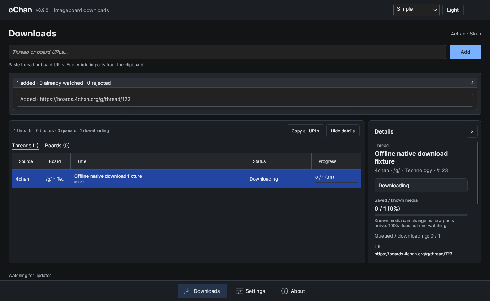
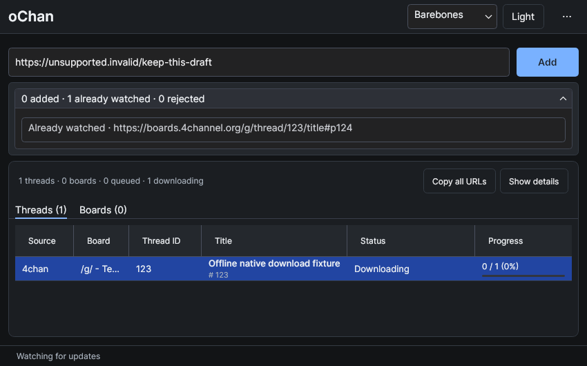
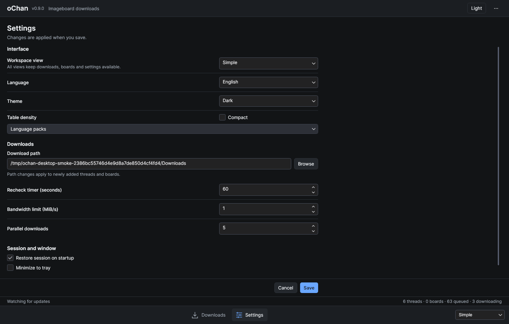

# MeowChan

MeowChan is a cross-platform imageboard downloader and offline archive for 4chan and 8kun. It watches threads and boards, saves their media and captured posts, and offers local archive search and portable single-thread HTML export. The Avalonia desktop app uses the independently consumable `libmeowchan` library; other applications can supply providers through its contracts.

Download published builds from the [MeowChan releases page](https://github.com/tfgrass/MeowChan/releases). Version **0.9.0 is in preparation and has not been released**; current releases are historical builds with their original artifact names. The [0.9.0 release-notes draft](docs/releases/v0.9.0.md) and [changelog](CHANGELOG.md) describe changes and upgrade considerations. See [platform requirements](docs/platform-support.md) before choosing a build, or [build from source](#build-and-run).

## What's new in 0.9.0

- A redesigned Avalonia interface with Barebones, Simple (default) and Advanced views of the same running session.
- Downloads, Sources, Archive, Rules, Diagnostics and Settings in a shared workspace; drafts and running downloads survive navigation.
- Dark and Light themes, normal or compact density, English and German, and optional JSON language packs.
- Comma- and newline-separated URL lists, with an individual result for every entry and a summary of the latest import.
- Thread and board details with their assigned folders, source state, current errors and media progress.
- Single-URL and whole-session copying in a format that can be imported again.
- A local archive with captured posts, retained original media versions and verified image previews, readable after a watch is removed.
- Media-type and maximum-size rules with Global → Source → Board → Thread inheritance and durable decisions for newly evaluated media.
- Diagnostics for current request cooldowns, download/storage errors and session warnings.

The 4chan/8kun providers, shared download queue, verified storage and durable sessions remain the foundation. `libmeowchan` continues to work independently of the UI. Final native package acceptance for 0.9.0 is still open.

## Desktop views

The first start uses **Simple**, **Dark**, **English** and normal density. Switch views without restarting downloads or losing the current selection and URL input:

| View | Presentation |
| --- | --- |
| **Barebones** | A smaller window with dense title/media rows, inline thread IDs and fewer decorative elements. |
| **Simple** | The default: combined source/board, title with inline thread ID, and status with media progress. |
| **Advanced** | Adds separate sortable columns for thread ID, status, queued media and active media downloads. |

Every view keeps thread/board tabs, URL admission, sorting, adjustable columns, details, context actions and settings. Advanced changes the information shown; it uses the same downloader. The view, theme, language and density are saved preferences. Window size, column layout and details-panel width are not saved across restarts.

Use the bottom navigation to switch pages. Simple includes Downloads, Archive and Settings; Wide Advanced windows also expose Rules and Diagnostics directly; narrower windows keep them under Tools. The application menu makes the implemented pages available in every view, including Barebones. About remains in the menu. The view selector is at the bottom right. Details start closed, and the latest import summary expands to show individual results. Action icons follow the menu's theme.







These are earlier UI previews from the isolated Linux harness at 100% scaling (Xvfb/Openbox, software rendering). Titles, URLs and states are passive test fixtures; no watches or network requests are started for these comparison scenes. Final MeowChan screenshots of Downloads, gallery, archive search, export and About have not yet been taken and will replace or supplement these previews after the UI is complete.

## Build and run

Use the exact .NET 10 SDK selected by `global.json` from a source checkout. Release builds use reviewed dependency lockfiles; [updating them](docs/platform-support.md#dependency-restores-and-updates) is an explicit maintainer step:

```sh
dotnet restore MeowChan.sln -p:Configuration=Release --locked-mode
dotnet build MeowChan.sln -c Release --no-restore
dotnet run --project MeowChan.csproj -c Release --no-build --no-restore
```

Desktop builds target Windows, macOS and Linux. Self-contained archives include the .NET runtime, so users do not need to install the SDK. Extract the complete archive: native libraries and license files beside the executable are required. macOS archives contain an unsigned `MeowChan.app` bundle that can be opened in Finder. Native macOS launch and Gatekeeper behavior still require release validation. See [platform requirements and package checks](docs/platform-support.md).

## Downloading

Enter one or more thread or board URLs and select **Add**, or press **Enter** in the URL field. Separate URLs with commas or newlines; **Shift+Enter** inserts a newline. A board watch discovers its threads automatically. Each entry receives a result, and invalid or failed entries do not prevent later entries from being processed. If any entry fails, the complete input list remains available for correction. Successful input is cleared only if it has not been edited during the import.

Selecting **Add** with an empty field reads the clipboard once. Explicit input uses only the entered text. **Ctrl+L** (**Cmd+L** on macOS) returns to Downloads and focuses the retained URL field. **Ctrl+V/Cmd+V** outside a text field in the main window imports the clipboard; inside text fields it pastes normally. The tray also offers clipboard import. These are user-triggered actions, with no automatic clipboard monitoring.

Use **Copy URL** for a single row or **Copy all URLs** for every watched thread and board, regardless of the selected tab. The copied list contains one URL per line and can be imported again.

Open **Show details**, use the row context menu, or double-click a row to see its URL, assigned destination and current errors. **Double-click now opens details instead of the folder.** Folder and browser actions remain available separately. Wide windows show details beside the table; narrow windows overlay them. **Escape** closes details and returns focus to the table.

Progress measures saved media against currently selected media, with rule exclusions shown separately; it does not measure transferred bytes. The known count can grow, and reaching 100% does not stop monitoring. Queued and active counts describe media jobs, not watched threads. An archived source does not imply that a local HTML archive exists. Rate limits and temporary HTTP failures are retried within bounded limits; cancellation waits for active work to stop.

Media is stored under:

```text
<download root>/<source>/<board>/<thread>/<media ID>.<extension>
```

Completed media is verified and recorded in a manifest. Files are published atomically; unrelated files are preserved. Interrupted transfers restart from the beginning. Removing a board stops discovery while its existing threads continue. Removing a thread also suppresses its automatic rediscovery; explicitly adding its URL allows it again.

## Archive, rules and diagnostics

The Archive page lists locally registered threads and reads captured posts and manifest-recorded original media. New threads capture posts by default; older restored watches start media-only unless capture was already enabled. Use the archive's capture action to change that preference explicitly. Removing a watch or disabling capture preserves the existing archive. The reader retains observed posts even when they disappear from later source responses; it cannot recover posts that were never captured.

Local posts remain readable without contacting the source. Supported images can be previewed from verified local files; unavailable files and unsupported previews are reported. Search retained text and titles, apply source/board/state filters and follow captured quotes or local backlinks without fetching remote targets. The archive export action creates a new portable HTML folder with its own CSS and matching verified saved originals; omission reasons are visible. Move the complete folder to retain offline reading. Existing export folders are not replaced. Video playback in the desktop reader, separate thumbnails and collection exports remain later work. The SQLite catalog (`archive.db`) stays in the local profile; media folders may live on a NAS. The writer atomically upgrades archive schema 1 to schema 2 for indexed search and quotes; keep a backup before upgrading because old schema-1-only readers cannot read the new catalog. Keep the profile and referenced media together when backing up, and stop the application before a simple file-copy backup. Existing v1 media manifests remain readable; new v2 history manifests are not supported by older binaries, so keep backups before upgrading.

Rules select allowed filename extensions and a maximum reported size. Each field inherits through Global → Source → Board → Thread, and the editor shows where its effective value comes from. Disabling an override restores inheritance. Sizes use decimal MB (1 MB = 1,000,000 bytes); media with unknown size remain eligible. Save affects newly evaluated media only: already recorded selections/exclusions and existing files remain unchanged, including after restart. This size setting is a metadata filter, not a hard transfer limit.

Diagnostics shows current session warnings, request cooldowns and watch/media/storage failures. You can copy details and navigate to the affected watch. It reflects current snapshots, not a complete event history or a source-wide online test.

## Settings and saved sessions

Settings control the output path, polling interval, global parallel downloads and bandwidth. Existing watches retain their assigned destinations when the output root changes. Threads added directly use the current root; threads discovered from an existing board keep that board's assigned root.

Settings also control theme, language, view, compact density and minimizing to the tray. **Save** validates and saves changes while staying on Settings; **Cancel** reloads the confirmed values without leaving the page. Navigation preserves pending edits, including invalid number text. Theme and view changes made in the footer save immediately and update only that field in a pending Settings draft. Existing settings files receive defaults for the new appearance preferences while retaining their download and session settings.

When **Restore session on startup** is enabled, confirmed changes to watched URLs are saved as they happen. The application restores them at startup. Settings/session failures are shown rather than silently replacing saved state. Only one running application can own a profile.

Fresh profiles use `%APPDATA%/.MeowChan` on Windows and `$HOME/.MeowChan` on macOS/Linux, with `settings.json` in that directory and a `Downloads/MeowChan` default media root. An existing `.oChan` profile remains in place and keeps its saved or implicit `Downloads/oChan` root. Set `MEOWCHAN_PROFILE` to select a profile explicitly; the legacy `OCHAN_PROFILE` override is also accepted. If both profile directories exist, select one explicitly. If both override variables are set, they must resolve to the same directory. Stop older applications before upgrading an existing profile or media store. Concurrent old/new applications on the same data and downgrading migrated data are unsupported.

English and German are built in. To add another language, place a plain JSON pack in `<active profile>/LanguagePacks`, restart, then select it in Settings. Missing translations fall back to English; an invalid or unavailable selected pack produces a warning and an English fallback. See the [language-pack format](Desktop/Localization/README.md). Technical provider and exception messages can remain untranslated.

## Library

The library project, assembly and new package ID are `libmeowchan`; current source uses `MeowChan.*` namespaces. Package consumers must update their PackageReference, using directives and any assembly references from earlier releases. The historical package is not automatically redirected, and the new package has not been published to NuGet. The desktop configuration, windows and Avalonia dependencies belong to the reference client.

```sh
dotnet pack libmeowchan/libmeowchan.csproj -c Release -o artifacts/packages
```

The [library guide](libmeowchan/README.md) covers sessions, persistent media rules, post capture and the passive offline reader. The [package consumer sample](samples/LibMeowChan.Consumer/README.md) shows how to restore the local package into a fresh cache and run a custom provider without the desktop app. The [session API](docs/Registry.md) describes lifetime and persistence ownership; the [download pipeline](docs/Downloader.md) explains completion and cancellation.

Provider registration is explicit. Sources shows registered adapter capabilities and actual watch observations. Provider descriptions are passive and optional. Dynamic plugin loading, a daemon, TUI and terminal browser remain later work. The library already exposes local search, quotes/backlinks and portable single-thread HTML export. Provider registration is independent of whether its website is currently reachable.

## Verification

```sh
dotnet test MeowChan.sln -c Release
dotnet build tests/MeowChan.DesktopSmoke/MeowChan.DesktopSmoke.csproj -c Release
python scripts/run-desktop-smoke.py --assembly tests/MeowChan.DesktopSmoke/bin/Release/net10.0/MeowChan.DesktopSmoke.dll --output artifacts/desktop-smoke
```

On Linux, the runner requires Xvfb, Openbox and a private session bus; missing tools fail without falling back to your desktop. Windows/macOS require a dedicated test desktop and `--allow-native-desktop`. Standard scenarios run serially and stop at the first failure. Rapid tray/window stress is a separate opt-in; do not run it on a personal workstation. See the [harness instructions](tests/MeowChan.DesktopSmoke/README.md) for prerequisites and targeted visual checks.

The harness covers page navigation/drafts, presentation/settings, profile conflicts, tray fallback and a download/restore session backed by local HTTP fixtures. It makes no public imageboard requests and does not replace testing freshly extracted release packages. See the [platform validation record](docs/platform-support.md) for evidence and remaining native checks.

## License

The project uses Artistic License 2.0; see [LICENSE](LICENSE). Desktop dependency and asset notices are in [THIRD-PARTY-NOTICES.md](THIRD-PARTY-NOTICES.md).
