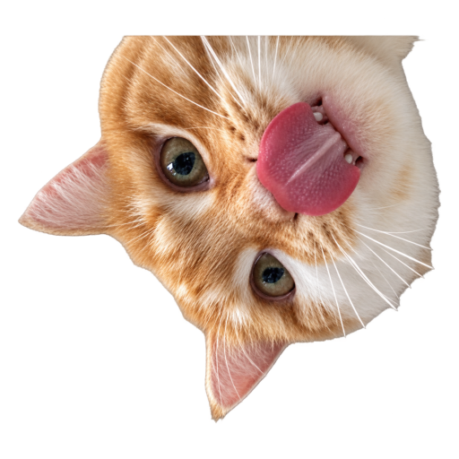
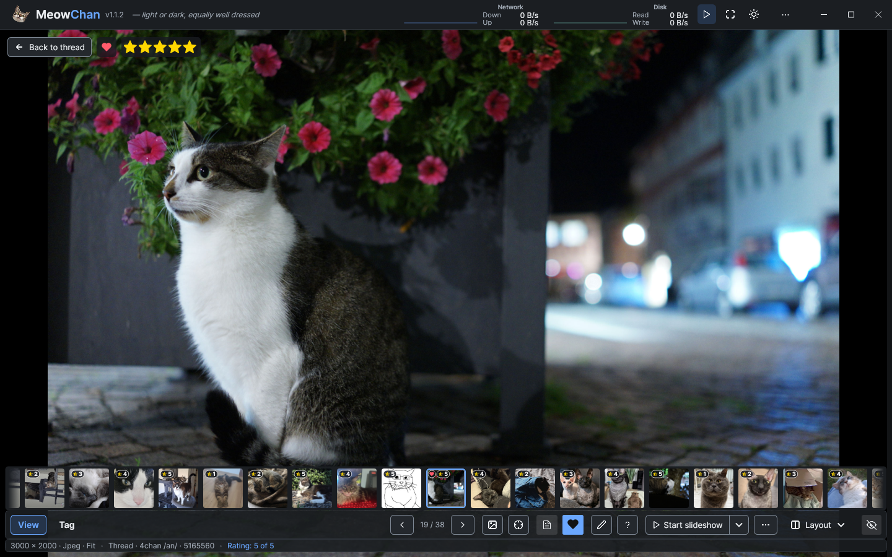
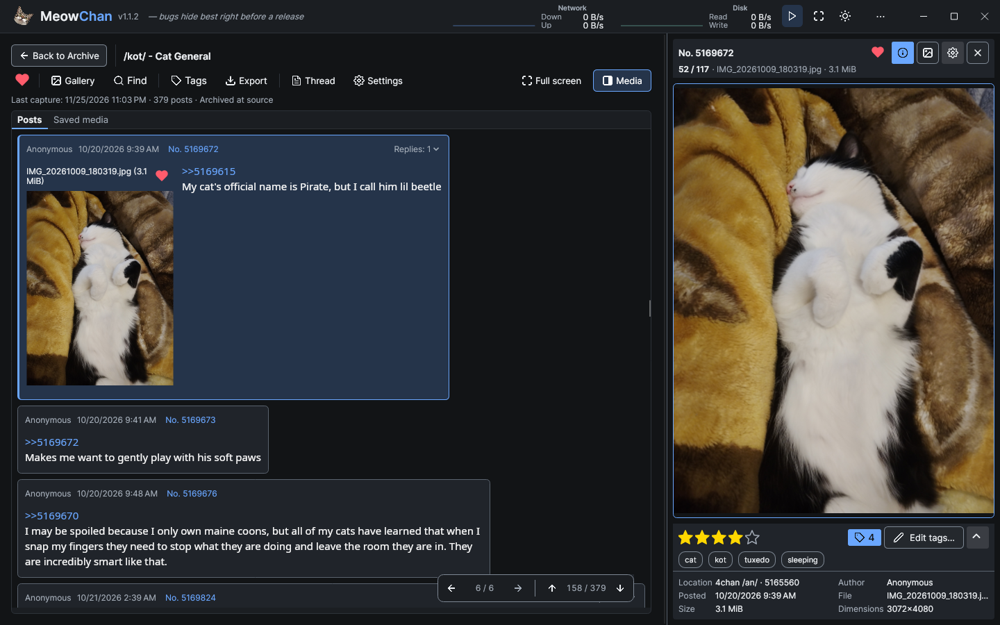
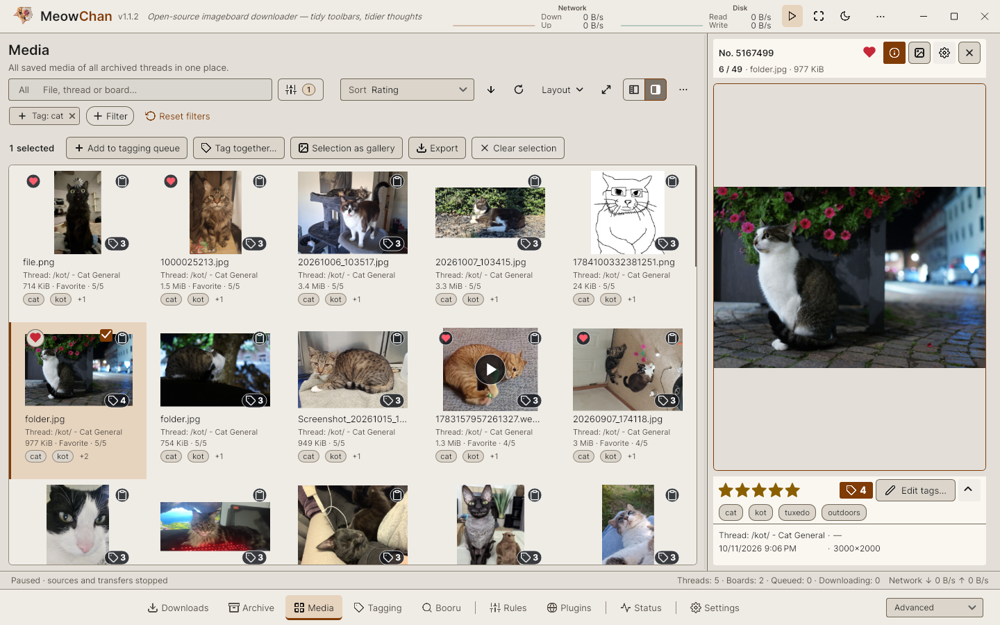
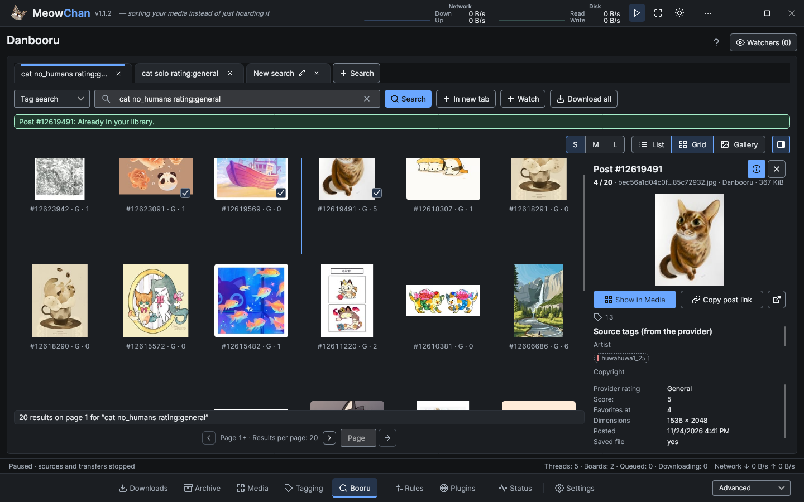
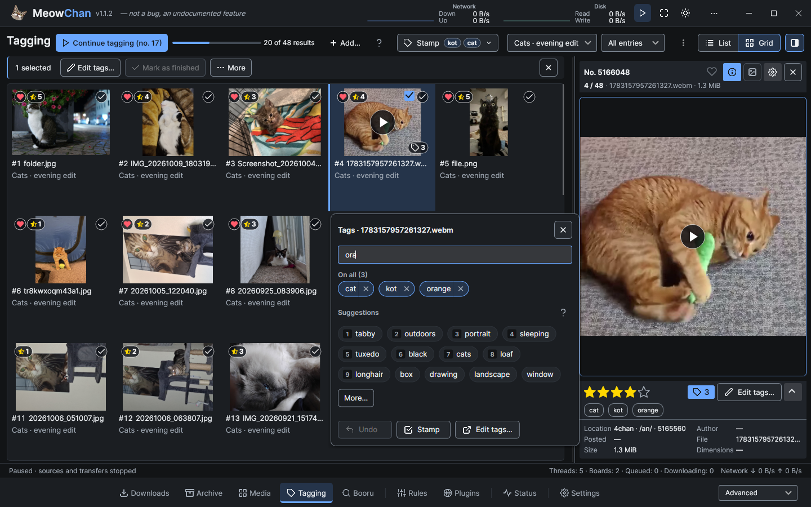
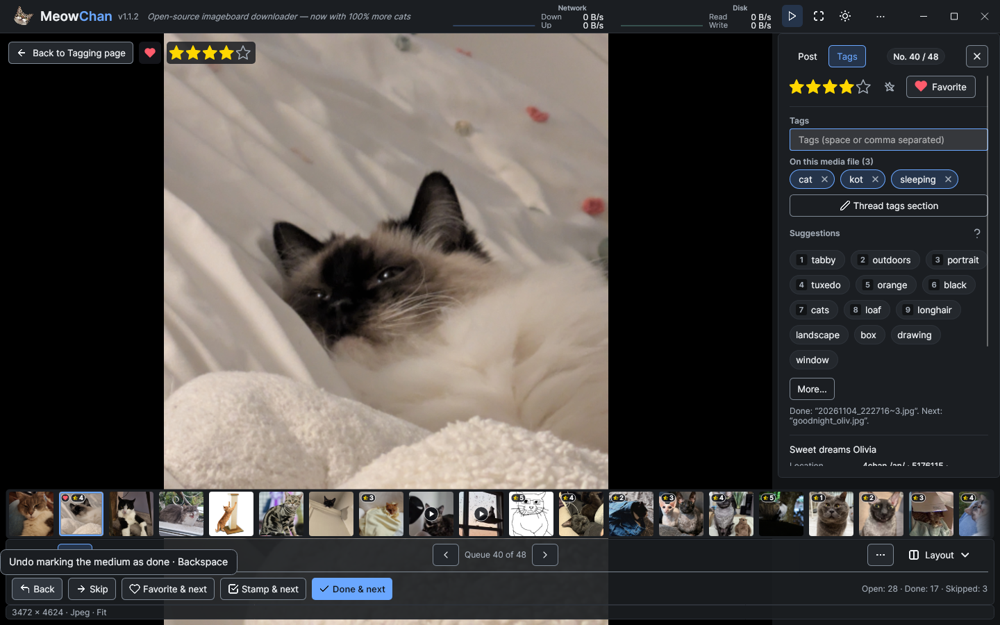
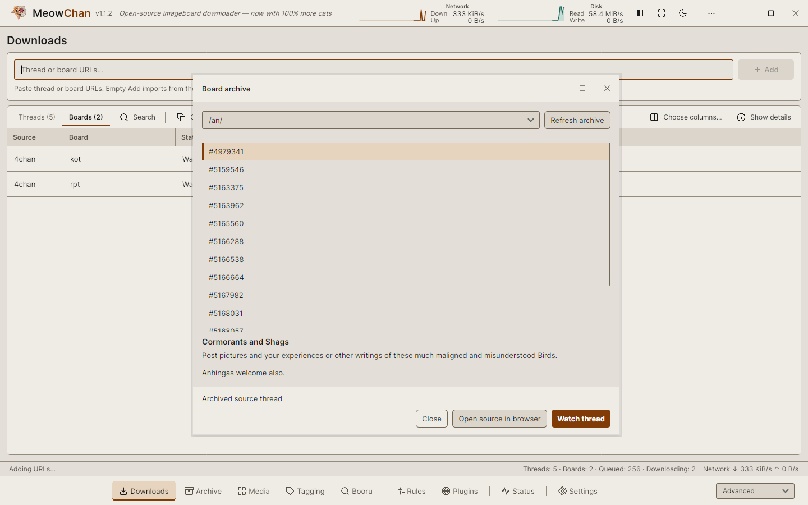

<p align="center">
  <picture>
    <source media="(prefers-color-scheme: dark)" srcset="Assets/meowchan-dark.png">
    
  </picture>
</p>

<h1 align="center">MeowChan</h1>

<p align="center"><strong>1.1.3 · Latest release</strong></p>

<p align="center">Original media. Better viewing. Your archive, offline.</p>

MeowChan is a desktop app that watches imageboard threads and boards and saves original media and posts on your computer. You can search and read captured threads offline, browse your media, or export a thread as a portable HTML folder.

[**Get MeowChan 1.1.3 →**](https://github.com/grassmann-it/MeowChan/releases/tag/v1.1.3) · [Quick start](#quick-start) · [User guide](docs/Help.md) · [Release notes](docs/releases/v1.1.3.md)

## What you can do with MeowChan

- **Watch threads and boards.** Follow a thread on a supported source such as 4chan or 8kun, or watch a board to discover new threads automatically. Preview the board’s threads and filter by title or opening post to choose which ones to follow. [Board watches](docs/Help.md#board-admission-and-exclusions)
- **Control your downloads.** Choose media types and size limits for all downloads or for a particular source, board or thread. Set a bandwidth limit, give a thread priority, or pause and resume unfinished transfers. [Rules](docs/Help.md#rule-templates) · [Download scheduling](docs/Help.md#download-scheduling)
- **Read and search your archive.** Search captured posts, save a search, and follow quotes and replies in the Reader. Resume at a saved reading position, bookmark a post with a note, or arrange threads into a reading group. Export selected threads and their saved media as one offline HTML collection. [Archive searches](docs/Help.md#archive-filters-and-saved-searches) · [HTML export](docs/Help.md#portable-html-export)
- **Browse the Gallery and Media page.** Zoom in on a photo or play a saved clip in the Gallery. On the Media page, filter your collection by tag, type or rating, see which threads share an identical file, and export matching originals. You can also import your own files or browse read-only media folders. [Media filters](docs/Help.md#media-filters-and-focus-mode) · [Importing files](docs/Help.md#importing-your-own-files)
- **Tag and rate what you save.** Give a thread or an exact media revision private tags. Work through untagged files in the tagging queue, apply a set of tags with a stamp, mark favourites with a heart and rate media from one to five stars. [Tagging queue](docs/Help.md#tagging-queue-and-settings) · [Media ratings](docs/Help.md#media-ratings)
- **Search Danbooru.** Open tag searches in Booru tabs and browse results as a list, grid or gallery. Download individual originals, restore saved search tabs at startup, or watch a query for new matches. [Danbooru searches and watchers](docs/Help.md#danbooru-search-and-watchers)
- **Manage plugins and sources.** Open **Plugins** to see what each source supports and enable the ones you want. Experimental sources start disabled. Five local filters cover dimensions, file size and names, SHA-256 blocklists, animation and file formats, and PNG metadata. [Plugin guide and inventory](docs/plugins/README.md)
- **Make the interface yours.** New profiles start in Simple view. Choose Barebones for a compact layout or Advanced for more controls. Pick a light or dark theme, choose one of six colour presets (each with its own heart and star colours), and customise keyboard shortcuts. The interface offers 12 languages, including ten preview translations. [Desktop views](docs/Help.md#desktop-view-defaults) · [Language packs](docs/Help.md#language-packs) · [Keyboard shortcuts](docs/Help.md#customizing-shortcuts)

## New in 1.1.3

- Read a text-only post and its saved replies side by side with the thread in the Reader.
- Watch selected GIFs in the media sidebars with interface animations enabled. Booru plays animated previews and samples from the source.
- Look up a picture’s public URL with SauceNAO, IQDB or Google Lens from its context menu.
- Press **B** in the Gallery to cycle picture backgrounds, or choose **Flip horizontally** to mirror the current image or video.

[Full 1.1.3 release notes](docs/releases/v1.1.3.md)

## Take a look around · 1.1.2

In the **Gallery**, the heart marks a favourite and the stars record its rating. The filmstrip keeps the next photo within reach. [All 12 screenshots and capture notes](docs/screenshots/1.1.2/README.md)

[](docs/screenshots/1.1.2/gallery-heart-stars-dark.png)

| Reader · post 158 of 379 | Media · sort by rating |
| --- | --- |
| [](docs/screenshots/1.1.2/reader-long-thread-dark.png) | [](docs/screenshots/1.1.2/media-rating-sort-light.png) |

| Booru · search tabs | Tagging · quick tags |
| --- | --- |
| [](docs/screenshots/1.1.2/booru-search-tabs-dark.png) | [](docs/screenshots/1.1.2/tagging-quick-tags-dark.png) |

| Tagging walk · undo | Downloads · board archive |
| --- | --- |
| [](docs/screenshots/1.1.2/tagging-walk-undo-dark.png) | [](docs/screenshots/1.1.2/board-archive-preview-light.png) |

[Earlier captures](docs/screenshots/) · [1.1.1](docs/screenshots/1.1.1/README.md) · [1.1.0](docs/screenshots/v1.1.0/README.md) · [1.0.1](docs/screenshots/v1.0.1/README.md) · [1.0.0](docs/screenshots/v1.0.0/README.md) · [0.9.0 layout and screenshots](docs/history/0.9.0-layout.md)

## Quick start

1. Choose your package below. On Windows, extract the whole ZIP and run `MeowChan.exe`. On macOS, open the DMG and drag `MeowChan.app` to Applications. On Linux, make the AppImage executable and run it, or extract a Linux archive and run `./MeowChan`.
2. Open **Settings**, choose a download folder and save. In **Downloads**, paste a supported thread or board URL and choose **Add**. For a board, review the threads you want to watch.
3. Open **Archive** after posts and media have been saved. Double-click a thread to read it, or right-click and choose **Open in gallery** or **Export as HTML**.

Moving from GChan? [Import your watches and saved files](docs/Help.md#moving-from-gchan) · [Deutsche Anleitung](docs/user-guide/gchan-umstieg.md)

## Downloads

| Platform | Download 1.1.3 |
| --- | --- |
| Windows x64 | [ZIP](https://github.com/grassmann-it/MeowChan/releases/download/v1.1.3/01-MeowChan-1.1.3-win-x64.zip) |
| macOS — Apple Silicon | [DMG](https://github.com/grassmann-it/MeowChan/releases/download/v1.1.3/02-MeowChan-1.1.3-osx-arm64.dmg) |
| macOS — Intel | [DMG](https://github.com/grassmann-it/MeowChan/releases/download/v1.1.3/03-MeowChan-1.1.3-osx-x64.dmg) |
| Linux x64 | [AppImage](https://github.com/grassmann-it/MeowChan/releases/download/v1.1.3/04-MeowChan-1.1.3-linux-x64.AppImage) |
| Linux ARM64 | [AppImage](https://github.com/grassmann-it/MeowChan/releases/download/v1.1.3/05-MeowChan-1.1.3-linux-arm64.AppImage) |

[All 1.1.3 packages, including Linux archives](docs/releases/v1.1.3.md#downloads) · [SHA256 checksums](https://github.com/grassmann-it/MeowChan/releases/download/v1.1.3/SHA256SUMS) · [Package validation](docs/releases/v1.1.3.md#validation-status)

### Platform requirements and upgrades

All desktop packages include .NET. Linux requires glibc, an X11 or XWayland session and native graphics and font libraries. AppImages and bundled-VLC archives include VLC. For a system-VLC archive, install LibVLC 3 (3.0.20 or newer) and its media and output plugins. The macOS app is ad-hoc signed and may need approval in Privacy & Security on first launch. [Platform requirements](docs/platform-support.md#upstream-requirements-checked-on-2026-10-10) · [Linux startup](docs/Help.md#linux-packages-and-startup) · [macOS first launch](docs/macos-signing.md)

Before upgrading, close MeowChan and any other writers, then back up the complete profile and media folders. Keep that copy separate so you can restore it if you need to go back. [Backup guide](docs/Help.md#upgrading-and-backups) · [1.1.1 upgrade notes](docs/releases/v1.1.1.md#upgrading-from-110) · [1.1.0 upgrade notes](docs/releases/v1.1.0.md#upgrading-from-102)

## Build and run

From a source checkout, use the .NET 10 SDK specified in [global.json](global.json). Restore the locked dependencies, build the solution and start the desktop app.

```sh
dotnet restore MeowChan.sln -p:Configuration=Release --locked-mode
dotnet build MeowChan.sln -c Release --no-restore
dotnet run --project MeowChan.csproj -c Release --no-build --no-restore
```

To use the downloader in your own .NET application, build the library package locally with `dotnet pack libmeowchan/libmeowchan.csproj -c Release -o artifacts/packages`. [Library guide](libmeowchan/README.md) · [Package consumer sample](samples/LibMeowChan.Consumer/README.md)

## Contributing

To report a problem, include your MeowChan version, operating system, package and the steps that reproduce it. Corrections to the preview translations are welcome. [Open an issue](https://github.com/grassmann-it/MeowChan/issues/new) · [Language pack guide](Desktop/Localization/Packs/README.md)

For code changes, run `dotnet test MeowChan.sln -c Release`. For desktop changes, the smoke harness also exercises the interface with local fixtures. [Desktop smoke instructions](tests/MeowChan.DesktopSmoke/README.md) · [Dependency updates](docs/platform-support.md#dependency-restores-and-updates)

You can also support development through the About window or [donate via PayPal](https://www.paypal.com/donate/?hosted_button_id=5BR4MK748PDSQ).

## Use and sources

When downloading, storing or sharing content, respect the source’s access rules and the permissions for that content.

## License

MeowChan uses the Artistic License 2.0. The bundled Inter and Noto Sans fonts use the SIL Open Font License 1.1. [License](LICENSE) · [Third-party notices](THIRD-PARTY-NOTICES.md)

Cat photos of Mila (grey) and Simba (orange) by Alexander Huxel. [Webentwicklung Huxel](https://webentwicklung-huxel.de/) · [Flickr](https://flickr.com/people/204852984@N05/)
