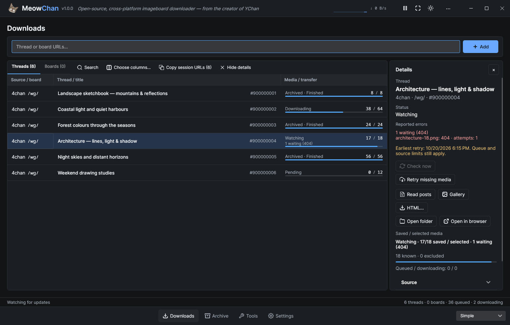
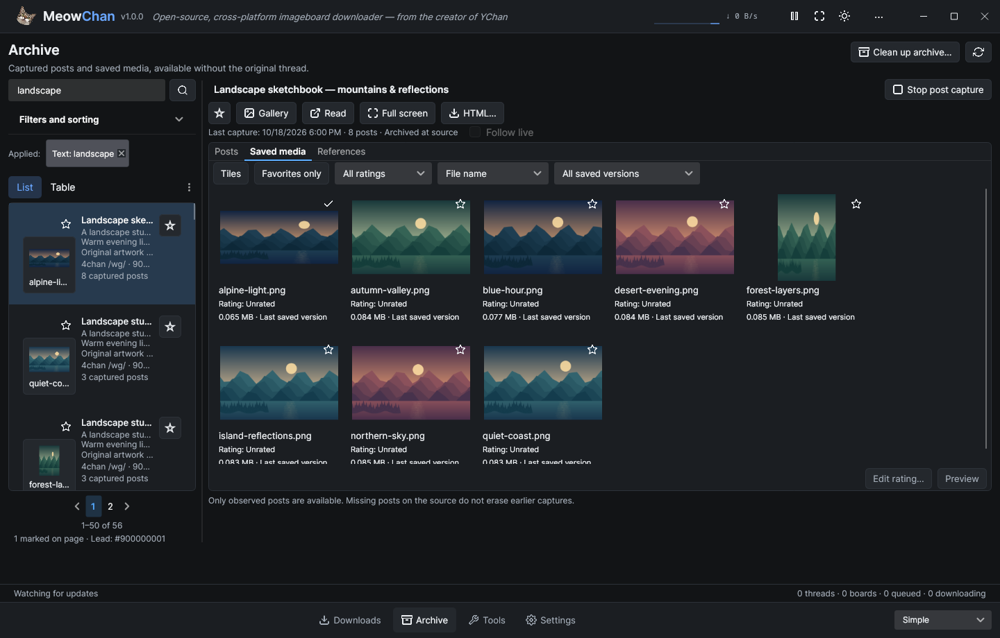
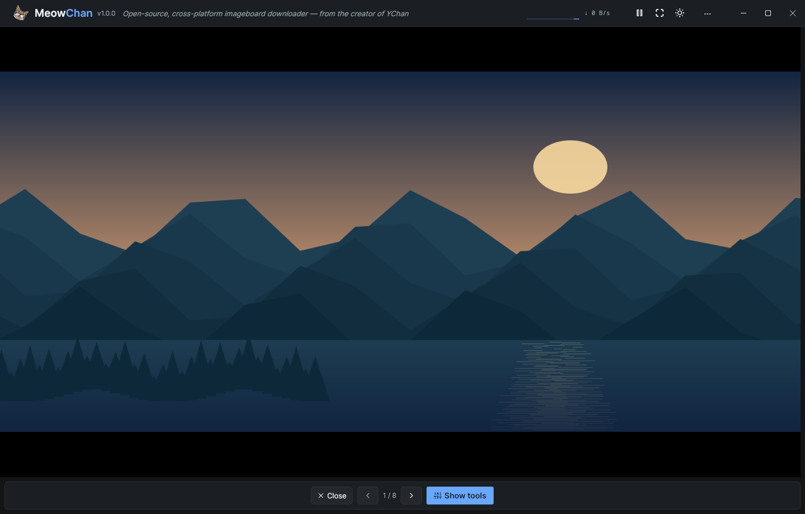
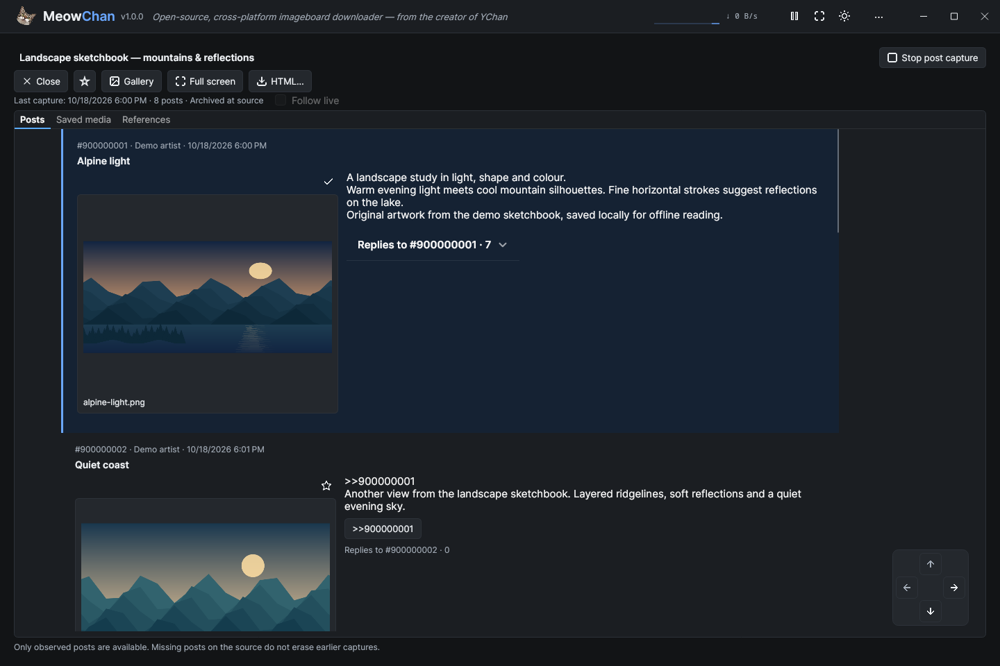

<p align="center">
  
</p>

<h1 align="center">MeowChan</h1>

<p align="center"><strong>1.0.0</strong></p>

<p align="center">More chans. Better reading. Your archive, offline.</p>

Save the threads you care about—and make them worth coming back to. **MeowChan** watches imageboard threads and boards, saves original media and captured posts, and turns your collection into a searchable offline reading workspace. Browse images and video, pick up where you left off, or take saved posts and verified originals with you as portable HTML.

[**Get MeowChan 1.0.0 →**](https://github.com/grassmann-it/MeowChan/releases/tag/v1.0.0) · [User guide](docs/Help.md) · [Release notes](docs/releases/v1.0.0.md) · [Platform requirements](docs/platform-support.md)

## What's new in 1.0 🐾

- **A fresh desktop.** The Semi + Ursa UI rework brings clearer layouts and consistent controls. Choose compact **Barebones**, **Simple** or **Advanced**, with Light/Dark themes, English/German and configurable shortcuts. Settings are organized into eight focused pages.
- **More chans, one collection.** **11 supplied sources** cover 4chan, 8kun, Lainchan, Kohlchan, Wizchan, Endchan, 2ch, Leftypol, Uboachan, ZZZchan and SushiChan. Experimental sources are marked and start disabled; registration does not guarantee live availability.
- **Keep the media you want.** **5 local media filters** cover dimensions, file size/original names, SHA-256 blocklists, animation/actual format and PNG metadata fields. The supplied inventory totals **16 plugins**, with **14 editable C# examples** and a bundled compiler. See the [plugin guide](docs/plugins/README.md) for installation, permissions and limits.
- **Settle in and read.** Save named reader groups, use optional Continue reading to return to your saved place, and keep post bookmarks and notes.
- **Find your favorites again.** Save archive searches, star threads and media, and rate media. Search captured posts and browse your collection without contacting the source.
- **Clear out the clutter.** Archive cleanup previews threads with **0–2 saved media versions**, protects favorites and other retained reading information, and lets you review losses before deletion.
- **Enjoy the originals.** Give images and video more room with the gallery’s optional **media focus** view; video has compact Play/Pause, seek, audio and repeat controls. Export verified originals or portable offline HTML collections.

The [1.0 release notes](docs/releases/v1.0.0.md) cover the changes and upgrade considerations; the [changelog](CHANGELOG.md) records the details. Back up your profile and media before upgrading. If you run into problems, [report an issue](https://github.com/grassmann-it/MeowChan/issues/new); use [0.9.0](https://github.com/grassmann-it/MeowChan/releases/tag/v0.9.0) only with an untouched profile or pre-upgrade backup.

## Take a look around · 1.0

These are current, source-built UI captures using offline demonstration data. The [1.0 capture notes](docs/screenshots/v1.0.0/README.md) record the source checkpoint and capture conditions; the images do not establish native package acceptance or live source availability.

### Watch threads without losing the overview

Paste thread or board URLs, track saved media and inspect watch details. Choose Barebones, Simple or Advanced to suit your workspace.

[](docs/screenshots/v1.0.0/downloads.png)

### Make your archive easy to come back to

Find captured threads and local media, save useful searches, and keep favorites and ratings close at hand. Prefer rows? There is also an [Archive table view](docs/screenshots/v1.0.0/archive-table.png).

[](docs/screenshots/v1.0.0/archive.png)

### Give the media some room

**Media focus** folds away gallery tools and details. Return to the [regular gallery](docs/screenshots/v1.0.0/gallery.png) when you want more controls and captured post context; video keeps its compact playback strip.

[](docs/screenshots/v1.0.0/gallery-focus.png)

### Settle in and read offline

Read captured posts with local media, follow replies, and return to saved reading positions. Reader groups, post bookmarks and notes help you keep your place.

[](docs/screenshots/v1.0.0/reader.png)

Explore the eight-page [Settings workspace](docs/screenshots/v1.0.0/settings.png) and [media rules](docs/screenshots/v1.0.0/rules.png). Historical 0.9.0 screenshots and their original source checkpoints remain in the [earlier interface gallery and capture notes](docs/screenshots/README.md).

## Quick start

Desktop packages cover **Windows x64, Linux x64/Arm64 and macOS Intel/Apple Silicon** and include .NET. Linux offers bundled-VLC archives, smaller system-VLC archives and bundled AppImages for both CPUs; it requires glibc and X11/XWayland. Separate macOS DMGs contain an ad-hoc-signed `MeowChan.app` and an Applications shortcut, without notarization. See [platform requirements](docs/platform-support.md) for dependencies and package details.

1. [Download MeowChan 1.0.0](https://github.com/grassmann-it/MeowChan/releases/tag/v1.0.0) and extract the **whole archive**, or open the macOS DMG and drag `MeowChan.app` to Applications. Start `MeowChan.exe`, `MeowChan` or `MeowChan.app` for your platform.
2. Set your download folder and media rules in Settings, then Save.
3. Paste a thread or board URL into Downloads and select Add. Boards discover their threads automatically.
4. Open Archive to find saved content. Double-click a thread to read it; use Shift+Enter or its context menu for the gallery, and the context menu for HTML export. Copy an entire exported folder for offline reading elsewhere.

### Choosing a Linux package

For each of `linux-x64` and `linux-arm64`, choose a package on the [1.0.0 release page](https://github.com/grassmann-it/MeowChan/releases/tag/v1.0.0):

| Filename | VLC requirement |
| --- | --- |
| `MeowChan-1.0.0-<RID>.AppImage` | Includes VLC; make executable and run. |
| `MeowChan-1.0.0-<RID>-bundled-vlc.tar.gz` | Includes VLC; extract the whole archive and run `./MeowChan`. |
| `MeowChan-1.0.0-<RID>-system-vlc.tar.gz` | Smaller archive; install compatible system LibVLC 3, version 3.0.20 or newer, and its media/output plugins first. |

Choose a bundled archive or AppImage to avoid a separate VLC installation. All variants include .NET. Linux checks the required VLC backend **before starting the session**: an absent, unsupported or unusable system backend shows an installation hint and exits with code 2 after acknowledgement. A damaged bundled backend requires re-extracting the complete package; it does not fall back to system VLC. A corrupt or unsupported media file remains a per-file error. See [Linux startup help](docs/Help.md#linux-packages-and-startup).

Downloads contain the application, runtime, icon and required legal notices only. The user guide, release notes, screenshots and developer documentation remain on GitHub; SDK samples, debug symbols and XML documentation are not shipped in the desktop archives.

The [practical user guide](docs/Help.md) explains gallery controls, missing media, repeat exports and safe upgrades. Source users can [build and run](#build-and-run) with the pinned .NET 10 SDK.

## Previous release: 0.9.0

- A redesigned Avalonia interface with Barebones as the default, plus Simple and Advanced views of the same running session. Each view remembers its own layout and table columns.
- Downloads, Sources, Archive, Rules, Diagnostics and Settings in a shared workspace; drafts and running downloads survive navigation.
- Dark, Light and System theme preferences, normal or compact density, English and German, and optional JSON language packs.
- Comma- and newline-separated URL lists, with an individual result for every entry and a summary of the latest import.
- Thread and board details with their assigned folders, source state, current errors and media progress.
- Single-URL and whole-session copying in a format that can be imported again.
- An offline archive with saved List/Table layouts, a resizable reader split, local search and a shared gallery with zoom/pan and captured post context.
- Persistent favorites for exact saved-media revisions, scoped favorite browsing and verified original-file export.
- Shared context commands and keyboard help, with F11 fullscreen across the workspace, reader and gallery.
- Portable HTML export to a new folder or an explicit update of a recognized previous result, with backup protection.
- Durable missing-media retries and a bounded source-end follow-up, with a separate manual repair action.
- Media-type and maximum-size rules with Global → Source → Board → Thread inheritance and durable decisions for newly evaluated media.
- Diagnostics for current request cooldowns, download/storage errors and session warnings.

The 4chan/8kun providers, shared download queue, verified storage and durable sessions remain the foundation. `libmeowchan` continues to work independently of the UI.

## Desktop views

The following layout reference describes the historical 0.9.0 interface. For the current workflow, see the [user guide](docs/Help.md).

MeowChan 0.9.0 uses **Barebones** for new profiles and missing or invalid view preferences, with **Dark**, **English** and normal density as the other appearance defaults. Saved Barebones, Simple and Advanced choices are retained. Switch views without restarting downloads or losing the current selection and URL input:

| View | Presentation |
| --- | --- |
| **Barebones** | The default: a smaller window with dense title/media rows, inline thread IDs and fewer decorative elements. |
| **Simple** | Combined source/board, title with inline thread ID, and status with media progress. |
| **Advanced** | Adds separate sortable columns for thread ID, status, queued media and active media downloads. |

Every view keeps thread/board tabs, URL admission, sorting, adjustable columns, details, context actions and settings. Advanced changes the information shown; it uses the same downloader. Theme and language are shared preferences. Each view retains its own density, reading size, archive layout and table column visibility, widths and order. Use **Columns** above a table to choose the fields or reset that table for the current view. Window geometry is also retained.

Use the bottom navigation to switch pages. Simple includes Downloads, Archive and Settings; Wide Advanced windows also expose Rules and Diagnostics directly; narrower windows keep them under Tools. The application menu makes the implemented pages available in every view, including Barebones. Click the cat in the upper-left header to open About; it is also available in the menu. The view selector is at the bottom right. Details start closed, and the latest import summary expands to show individual results. Action icons follow the menu's theme.

## Build and run

Use the exact .NET 10 SDK selected by `global.json` from a source checkout. Release builds use reviewed dependency lockfiles; [updating them](docs/platform-support.md#dependency-restores-and-updates) is an explicit maintainer step:

```sh
dotnet restore MeowChan.sln -p:Configuration=Release --locked-mode
dotnet build MeowChan.sln -c Release --no-restore
dotnet run --project MeowChan.csproj -c Release --no-build --no-restore
```

Desktop builds target Windows, macOS and Linux. Self-contained archives include the .NET runtime, so users do not need to install the SDK. Extract the complete archive: native libraries and license files beside the executable are required. On macOS, open the DMG and drag the ad-hoc-signed `MeowChan.app` to Applications; see [macOS first-launch guidance](docs/macos-signing.md) for manual approval in Privacy & Security. See [platform requirements and package checks](docs/platform-support.md) for the recorded evidence and its limits.

## Downloading

Enter one or more thread or board URLs and select **Add**, or press **Enter** in the URL field. Separate URLs with commas or newlines; **Shift+Enter** inserts a newline. A board watch discovers its threads automatically. Each entry receives a result, and invalid or failed entries do not prevent later entries from being processed. If any entry fails, the complete input list remains available for correction. Successful input is cleared only if it has not been edited during the import.

Selecting **Add** with an empty field reads the clipboard once. Explicit input uses only the entered text. **Ctrl+L** (**Cmd+L** on macOS) returns to Downloads and focuses the retained URL field. **Ctrl+V/Cmd+V** in Downloads outside native controls imports the clipboard; inside text fields it pastes normally. The tray also offers clipboard import. These are user-triggered actions, with no automatic clipboard monitoring.

Use **Copy URL** for a single row or **Copy all URLs** for every watched thread and board, regardless of the selected tab. The copied list contains one URL per line and can be imported again.

Double-click a thread row to open the large reader. Shift+Enter or the context menu opens its gallery. Board rows open details. Use **Show details** or the row context menu to inspect a thread’s URL, assigned destination and current errors. Folder and browser actions remain available separately. Wide windows show details beside the table; narrow windows overlay them. **Escape** closes details and returns focus to the table.

The header shows download speed from received media bytes, with a compact history graph in wider windows.

Progress measures saved media against currently selected media, with rule exclusions shown separately; it does not measure transferred bytes. The known count can grow, and reaching 100% does not stop monitoring. Queued and active counts describe media jobs, not watched threads. An archived source does not imply that a local HTML archive exists. Rate limits and temporary HTTP failures are retried within bounded limits; cancellation waits for active work to stop.

Missing-media 404s wait 15/30/60/120/240 minutes, then at least 240; Check now respects those pauses. Retry missing media grants one attempt through the normal queue without clearing failure history. Automatic 404 follow-up ends 12 hours after the first durably recorded source end. A finished thread can retain missing 404 media; other exhausted failures require intervention. See the [retry guide](docs/Help.md#missing-media-and-finished-threads).

Media is stored under:

```text
<download root>/<source>/<board>/<thread>/<media ID>.<extension>
```

Completed media is verified and recorded in a manifest. Files are published atomically; unrelated files are preserved. Interrupted transfers restart from the beginning. Removing a board stops discovery while its existing threads continue. Removing a thread also suppresses its automatic rediscovery; explicitly adding its URL allows it again.

### Selection, board intake and full pause

Use Shift/Ctrl (Command on macOS) multi-selection and
context actions for selected watches/exports. Delete removes the selection. Enter
and **Read posts** require exactly one selected thread. Shift+Enter opens the
focused lead thread’s gallery. Inputs retain their own keys. In the Board list only,
Ctrl/Cmd+Shift+R opens **Thread filters…** for the focused board.
Board intake previews catalog threads by default, with literal title/opening-post
filters, reasons and per-thread choices. Cancel leaves the whole pasted batch
unadded. Removed board threads stay durably excluded until reactivated; filter
changes affect future admissions while existing watches continue.

Full Pause cancels active source checks and transfers, showing Pausing until they
quiesce. Resume retries unfinished work while keeping verified files and existing
retry/deadline history. See the [user guide](docs/Help.md#board-admission-and-exclusions).

## Archive, rules and diagnostics

The Archive page lists locally registered threads and reads captured posts and manifest-recorded original media. New threads capture posts by default; older restored watches start media-only unless capture was already enabled. Use the archive's capture action to change that preference explicitly. Removing a watch or disabling capture preserves the existing archive. The reader retains observed posts even when they disappear from later source responses; it cannot recover posts that were never captured.

### Gallery and local search

Choose List or Table for Archive threads; the layout and list/reader split are saved, with a separate-pane view in narrow windows. **Read posts** and Enter require exactly one selected thread in Downloads or Archive; Shift+Enter opens the lead thread’s gallery. Local posts remain readable without contacting the source. Search retained titles, text and identities, filter by source/board/state, and follow captured quotes or local backlinks. **Media from matching threads** takes a sequence from all matching threads across all pages in the current order; filters changed later do not replace that open sequence. Double-click a saved-media row/tile, or press Enter while it has focus, to start with that exact item and preserve the current media sort/version filter.

A large reader fills the work area with readable posts and embedded media; Up/Down moves exactly one post. Left/Right moves to the previous/next thread in the frozen current list or search order, including across result pages, without wrapping. A thread opened without a list scope does not gain a global thread sequence. Text fields retain their normal arrow keys. F11 enters/exits fullscreen while preserving the active workspace; Escape dismisses active overlays before leaving fullscreen. F1 shows keyboard help. See the [shortcut guide](docs/Help.md#selection-and-shortcuts).

In the gallery, Left/Right moves between media. Fit/1:1, +/− and wheel/touchpad gestures control zoom; fractional touchpad deltas produce finer changes. Zooming out stops at Fit, where the image is centered and pan resets. Drag a zoomed image to pan; double-click switches Fit/1:1 and Escape closes the gallery. Open from reader post A, navigate to media associated with saved post D, and close to return to the large reader at D. Without a saved post association, retain the prior reader anchor. Search/media-list origins instead restore their query, filters, page, scroll and focus.

**F** toggles the current gallery favorite; **P** toggles post context, **0** selects Fit and **1** selects 1:1. Stars also mark reader attachments and saved-media items. **Show favorites** offers current-thread, selected-thread, matching-thread and all-favorite scopes. **Export favorite originals…** copies verified originals by source/board/thread without overwriting existing files or fetching remote content; **Export original…** copies one item. Marks persist for the exact saved revision. See [favorites and original export](docs/Help.md#favorites-and-original-file-export).

PNG, JPEG, GIF, WebP and BMP depend on decoder support; animation shows a still first frame. Image previews refuse files above 64 MiB or 80 million source pixels; Fit buffers are bounded to 16 million pixels. Missing, unsupported or unverifiable previews report a reason while saved originals remain on disk.

Video attachments in captured posts can reuse persistent still previews offline, generated from verified saved originals. If a preview is unavailable, open the original in the gallery for playback.

MeowChan includes a bounded LibVLC player for local media. Linux uses the chosen bundled or system VLC backend and checks it before session startup; Windows/macOS use official VideoLAN native assets. All desktop variants include .NET; only the Linux system-VLC variant needs a separate VLC installation. See the [platform record](docs/platform-support.md) for native playback and audio/OS coverage.

### Portable HTML export

A multi-selection can also create one combined folder with a landing page,
individual thread pages and shared verified media. Smart repeat export recognizes
the same ordered selection for explicit update or a new folder; a changed
selection starts a new export. Member read times remain separate, rather than
claiming one simultaneous capture. See [combined exports](docs/Help.md#combined-export-of-selected-threads).

Export a thread from Archive or its reader. Only captured posts and matching verified saved originals are included; export never fetches remote content. Media-only threads export as a gallery. Copy the **entire folder** and open its `index.html` for portable offline reading.

For a recognized earlier result, **New folder** keeps the previous copy and remains the default. **Update existing export** explicitly rebuilds that result; changed/extra files, associated legacy exports or reduced output require confirmation to retain the old folder as a backup. Open previous export and the successful current result’s Open folder are separate actions. See the [export guide](docs/Help.md#portable-html-export) for association, backup and space requirements.

The SQLite catalog (`archive.db`) stays in the local profile; media folders may live on a NAS. Back up the complete profile and referenced media with the writer stopped. Current writers migrate archive schemas 1–3 to schema 4; passive readers can read schemas 1–4 without migration. V1 and V2 media manifests remain readable; new writes use V3, which binds attachment revisions to saved media and records provider metadata, local integrity values and acceptance evidence. Older binaries may not understand these formats. No downgrade path is promised; keep backups before upgrading.

Rules select allowed filename extensions and a maximum file size. Each field inherits through Global → Source → Board → Thread, and the editor shows where its effective value comes from. Disabling an override restores inheritance. Sizes use decimal MB (1 MB = 1,000,000 bytes). Provider sizes guide preselection; media with unknown size are initially eligible. Downloaded bytes must also stay within the effective limit for that medium. Saving rules affects newly evaluated media; it does not automatically reconsider recorded selections/exclusions or alter existing files, including after restart.

Diagnostics shows current session warnings, request cooldowns and watch/media/storage failures. You can copy details and navigate to the affected watch. It reflects current snapshots, not a complete event history or a source-wide online test.

## Settings and saved sessions

Settings control the output path, polling interval, global parallel downloads and bandwidth. Existing watches retain their assigned destinations when the output root changes. Threads added directly use the current root; threads discovered from an existing board keep that board's assigned root.

Settings also control theme, language, view and compact density. **Close to tray** and **Minimize to tray** are separate preferences: the first controls X, the second the minimize button. Both default to off. With a reachable tray, enabled actions hide the window and remove its taskbar entry; the tray icon or its Open action restores it. On Linux, a registered StatusNotifier host is checked before hiding; if the host disappears, the window returns. An unavailable tray keeps the window reachable in the taskbar. Existing profiles keep the old close behavior; their previous Minimize to tray value migrates to Close to tray, while the new minimize preference starts off. **Save** validates and saves changes while staying on Settings; **Cancel** reloads the confirmed values without leaving the page. Navigation preserves pending edits, including invalid number text. Theme and view changes made in the footer save immediately and update only that field in a pending Settings draft. Existing settings files receive defaults for the new appearance preferences while retaining their download and session settings.

When session saving is enabled, confirmed changes to watched URLs are saved as they happen. The application restores saved watches at startup. Disabling **Save URLs on exit** prevents automatic watch restoration from the URL list and durable work state; it does not erase the archive. Settings/session failures are shown rather than silently replacing saved state. Only one running application can own a profile.

Fresh profiles use `%APPDATA%/.MeowChan` on Windows and `$HOME/.MeowChan` on macOS/Linux, with `settings.json` in that directory and a `Downloads/MeowChan` default media root. An existing installation’s profile remains in place when it is the only profile, preserving its configured or implicit media destination. Set `MEOWCHAN_PROFILE` to select a profile explicitly; the older environment-variable alias is also accepted. If both profile directories exist, select one explicitly. If both override variables are set, they must resolve to the same directory. Stop older applications before upgrading an existing profile or media store. Concurrent old/new applications on the same data and downgrading migrated data are unsupported.

English and German are built in. To add another language, place a plain JSON pack in `<active profile>/LanguagePacks`, restart, then select it in Settings. Missing translations fall back to English; an invalid or unavailable selected pack produces a warning and an English fallback. See the [language-pack format](Desktop/Localization/README.md). Technical provider and exception messages can remain untranslated.

## Library

The library project, assembly and new package ID are `libmeowchan`; current source uses `MeowChan.*` namespaces. Package consumers must update their PackageReference, using directives and any assembly references from earlier releases. The historical package is not automatically redirected, and the new package has not been published to NuGet. The desktop configuration, windows and Avalonia dependencies belong to the reference client.

```sh
dotnet pack libmeowchan/libmeowchan.csproj -c Release -o artifacts/packages
```

The [library guide](libmeowchan/README.md) covers sessions, persistent media rules, post capture and the passive offline reader. The [package consumer sample](samples/LibMeowChan.Consumer/README.md) shows how to restore the local package into a fresh cache and run a custom provider without the desktop app. The [session API](docs/Registry.md) describes lifetime and persistence ownership; the [download pipeline](docs/Downloader.md) explains completion and cancellation.

Provider registration is explicit. Sources shows registered adapter capabilities and actual watch observations. Provider descriptions are passive and optional. MeowChan 1.0 includes SDK-only C# source/image-filter plugins and an optional process host; see the [plugin author and installation guide](docs/plugins/README.md) for examples, activation and current validation limits. The core library does not require the plugin host or compiler. A daemon, TUI and terminal browser remain later work. The library already exposes local search, quotes/backlinks and portable single-thread HTML export. Provider registration is independent of whether its website is currently reachable.

## Verification

```sh
dotnet test MeowChan.sln -c Release
dotnet build tests/MeowChan.DesktopSmoke/MeowChan.DesktopSmoke.csproj -c Release
python scripts/run-desktop-smoke.py --assembly tests/MeowChan.DesktopSmoke/bin/Release/net10.0/MeowChan.DesktopSmoke.dll --output artifacts/desktop-smoke
```

On Linux, the runner requires Xvfb, Openbox and a private session bus; missing tools fail without falling back to your desktop. Windows/macOS require a dedicated test desktop and `--allow-native-desktop`. Standard scenarios run serially and stop at the first failure. Rapid tray/window stress is a separate opt-in; do not run it on a personal workstation. See the [harness instructions](tests/MeowChan.DesktopSmoke/README.md) for prerequisites and targeted visual checks.

The harness covers page navigation/drafts, presentation/settings, profile conflicts, tray fallback and a download/restore session backed by local HTTP fixtures. It makes no public imageboard requests and does not replace testing freshly extracted release packages. See the [platform validation record](docs/platform-support.md) for package evidence and its limits.

## Support MeowChan

If MeowChan helps you, you can voluntarily [support its development via PayPal](https://www.paypal.com/donate/?hosted_button_id=5BR4MK748PDSQ). The same link is available in the app's About window.

## License

The project uses Artistic License 2.0; see [LICENSE](LICENSE). Desktop dependency and asset notices are in [THIRD-PARTY-NOTICES.md](THIRD-PARTY-NOTICES.md).
