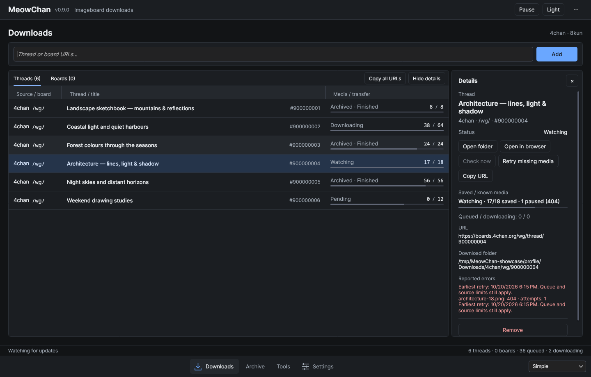
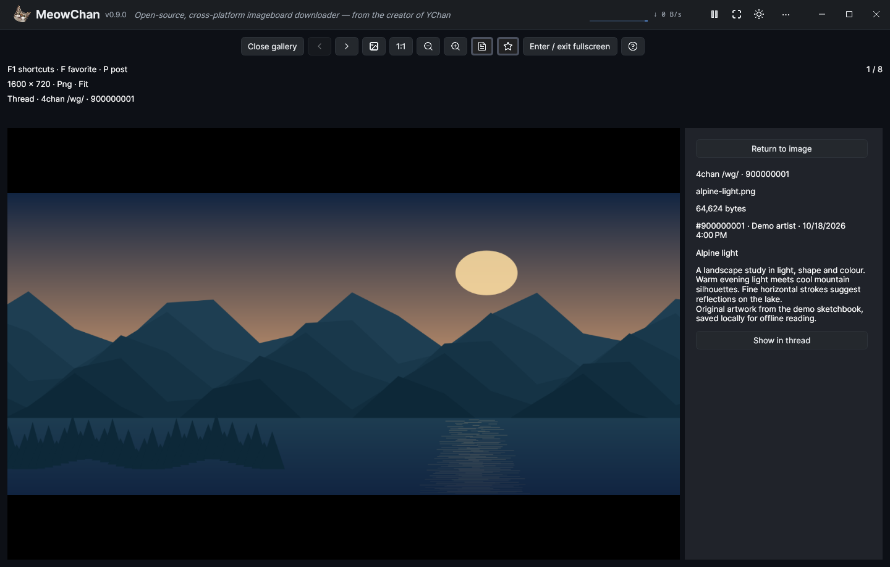
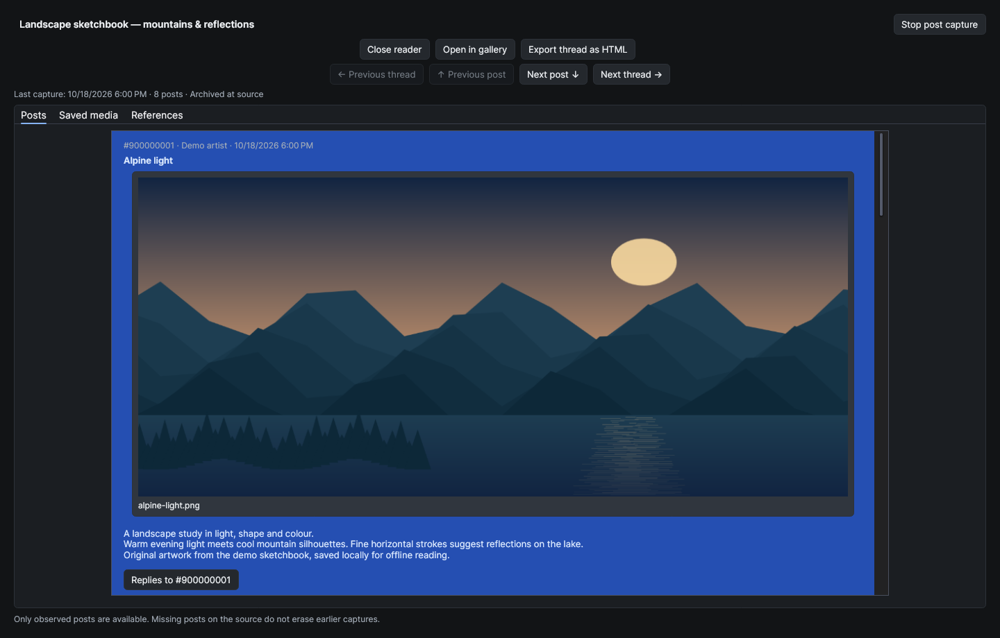
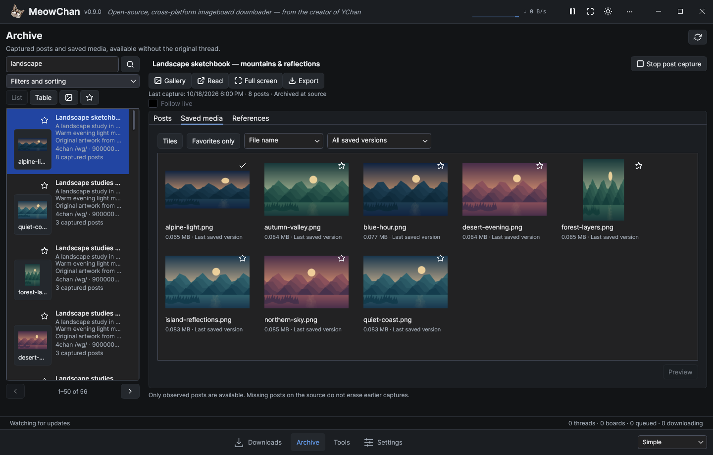

<p align="center">
  
</p>

<h1 align="center">MeowChan</h1>

<p align="center"><strong>0.9.0 · In preparation</strong></p>

<p align="center">oChan is now MeowChan.<br>Save threads. Browse your archive. Keep it offline.</p>

MeowChan is a cross-platform imageboard downloader and offline archive for 4chan and 8kun, with an image gallery, local search and portable HTML export. It watches threads and boards and saves their original media and captured posts. The Avalonia desktop app uses the independently consumable `libmeowchan` library; other applications can supply providers through its contracts.

Download published builds from the [MeowChan releases page](https://github.com/tfgrass/MeowChan/releases). Stable **0.9.0 is in preparation**. The Windows x64 compatibility preview is [0.9.0 Preview 3](https://github.com/tfgrass/MeowChan/releases/tag/v0.9.0-preview.3), with .NET 10 and VLC included. Extract the whole ZIP and launch `MeowChan.exe`. It carries fixes for profile database handles retained after host shutdown and a start window larger than the available work area. Full desktop and hardware acceptance remains open. Older releases retain their original artifact names. The [0.9.0 release-notes draft](docs/releases/v0.9.0.md) and [changelog](CHANGELOG.md) describe changes and upgrade considerations. See [platform requirements](docs/platform-support.md) before choosing a build, or [build from source](#build-and-run).

## Quick start

Planned desktop package targets are **Windows x64, Linux x64/Arm64 and macOS Intel/Apple Silicon**. Self-contained archives include .NET. Linux requires glibc and X11/XWayland; the macOS standard is separate self-contained Intel/Apple Silicon `.app` ZIPs with ad-hoc signatures and no notarization, with Homebrew source builds optional. Final native acceptance remains open; check the [platform requirements](docs/platform-support.md) for current evidence.

The steps below describe the 0.9.0 interface and candidate launchers. Published older builds retain their original launcher names and controls.

1. [Download a published build](https://github.com/tfgrass/MeowChan/releases) and extract the **whole archive**. Start `MeowChan.exe`, `MeowChan` or `MeowChan.app` for your platform.
2. Set your download folder and media rules in Settings, then Save.
3. Paste a thread or board URL into Downloads and select Add. Boards discover their threads automatically.
4. Open Archive to find saved content. Double-click a thread to read it; use Shift+Enter or its context menu for the gallery, and the context menu for HTML export. Copy an entire exported folder for offline reading elsewhere.

The [practical user guide](docs/Help.md) explains gallery controls, missing media, repeat exports and safe upgrades. Source users can [build and run](#build-and-run) with the pinned .NET 10 SDK.

## Downloads, gallery, reader and archive

[](docs/screenshots/v0.9.0-downloads.png)

Downloads keeps watched threads and their saved/selected media progress together. Details show a temporary media 404 and its earliest retry while the thread remains watched.

[](docs/screenshots/v0.9.0-gallery.png)

Browse local images at Fit or 1:1, zoom and pan, and show the associated captured post.

[](docs/screenshots/v0.9.0-reader.png)

Read captured posts at full window size, with large local media and navigation between posts and threads.

[](docs/screenshots/v0.9.0-archive.png)

Find retained threads and media offline. Open images from all matching threads across every results page.

These scenes show the integrated interface using original offline demo artwork and synthetic posts, captured through an isolated Linux Xvfb/Openbox harness at 100% scaling with software rendering. Downloads uses passive example states; archive, gallery, reader and export use persisted local data. The captures do not demonstrate live source availability or native package acceptance. Supplementary captures show [repeat HTML export](docs/screenshots/v0.9.0-export.png) and [About with the MeowChan cat](docs/screenshots/v0.9.0-about.png). See the [image provenance](docs/screenshots/README.md).

## What's new in 0.9.0

- A redesigned Avalonia interface with Barebones, Simple (default) and Advanced views of the same running session.
- Downloads, Sources, Archive, Rules, Diagnostics and Settings in a shared workspace; drafts and running downloads survive navigation.
- Dark and Light themes, normal or compact density, English and German, and optional JSON language packs.
- Comma- and newline-separated URL lists, with an individual result for every entry and a summary of the latest import.
- Thread and board details with their assigned folders, source state, current errors and media progress.
- Single-URL and whole-session copying in a format that can be imported again.
- An offline archive with local search, saved-media tiles and a shared gallery with navigation, zoom/pan and captured post context.
- Portable HTML export to a new folder or an explicit update of a recognized previous result, with backup protection.
- Durable missing-media retries and a bounded source-end follow-up, with a separate manual repair action.
- Media-type and maximum-size rules with Global → Source → Board → Thread inheritance and durable decisions for newly evaluated media.
- Diagnostics for current request cooldowns, download/storage errors and session warnings.

The 4chan/8kun providers, shared download queue, verified storage and durable sessions remain the foundation. `libmeowchan` continues to work independently of the UI. Final native package acceptance for 0.9.0 is still open.

## Desktop views

The first start uses **Simple**, **Dark**, **English** and normal density. Switch views without restarting downloads or losing the current selection and URL input:

| View | Presentation |
| --- | --- |
| **Barebones** | A smaller window with dense title/media rows, inline thread IDs and fewer decorative elements. |
| **Simple** | The default: combined source/board, title with inline thread ID, and status with media progress. |
| **Advanced** | Adds separate sortable columns for thread ID, status, queued media and active media downloads. |

Every view keeps thread/board tabs, URL admission, sorting, adjustable columns, details, context actions and settings. Advanced changes the information shown; it uses the same downloader. The view, theme, language and density are saved preferences. Window size, column layout and details-panel width are not saved across restarts.

Use the bottom navigation to switch pages. Simple includes Downloads, Archive and Settings; Wide Advanced windows also expose Rules and Diagnostics directly; narrower windows keep them under Tools. The application menu makes the implemented pages available in every view, including Barebones. About remains in the menu. The view selector is at the bottom right. Details start closed, and the latest import summary expands to show individual results. Action icons follow the menu's theme.

## Build and run

Use the exact .NET 10 SDK selected by `global.json` from a source checkout. Release builds use reviewed dependency lockfiles; [updating them](docs/platform-support.md#dependency-restores-and-updates) is an explicit maintainer step:

```sh
dotnet restore MeowChan.sln -p:Configuration=Release --locked-mode
dotnet build MeowChan.sln -c Release --no-restore
dotnet run --project MeowChan.csproj -c Release --no-build --no-restore
```

Desktop builds target Windows, macOS and Linux. Self-contained archives include the .NET runtime, so users do not need to install the SDK. Extract the complete archive: native libraries and license files beside the executable are required. The planned macOS ZIPs contain an ad-hoc-signed `MeowChan.app` bundle for Intel or Apple Silicon; see [macOS first-launch guidance](docs/macos-signing.md) for manual approval in Privacy & Security. Native macOS launch and Gatekeeper behavior still require release validation. See [platform requirements and package checks](docs/platform-support.md).

## Downloading

Enter one or more thread or board URLs and select **Add**, or press **Enter** in the URL field. Separate URLs with commas or newlines; **Shift+Enter** inserts a newline. A board watch discovers its threads automatically. Each entry receives a result, and invalid or failed entries do not prevent later entries from being processed. If any entry fails, the complete input list remains available for correction. Successful input is cleared only if it has not been edited during the import.

Selecting **Add** with an empty field reads the clipboard once. Explicit input uses only the entered text. **Ctrl+L** (**Cmd+L** on macOS) returns to Downloads and focuses the retained URL field. **Ctrl+V/Cmd+V** outside a text field in the main window imports the clipboard; inside text fields it pastes normally. The tray also offers clipboard import. These are user-triggered actions, with no automatic clipboard monitoring.

Use **Copy URL** for a single row or **Copy all URLs** for every watched thread and board, regardless of the selected tab. The copied list contains one URL per line and can be imported again.

Double-click a thread row to open the large reader. Shift+Enter or the context menu opens its gallery. Board rows open details. Use **Show details** or the row context menu to inspect a thread’s URL, assigned destination and current errors. Folder and browser actions remain available separately. Wide windows show details beside the table; narrow windows overlay them. **Escape** closes details and returns focus to the table.

Progress measures saved media against currently selected media, with rule exclusions shown separately; it does not measure transferred bytes. The known count can grow, and reaching 100% does not stop monitoring. Queued and active counts describe media jobs, not watched threads. An archived source does not imply that a local HTML archive exists. Rate limits and temporary HTTP failures are retried within bounded limits; cancellation waits for active work to stop.

Missing-media 404s wait 15/30/60/120/240 minutes, then at least 240; Check now respects those pauses. Retry missing media grants one attempt through the normal queue without clearing failure history. Automatic 404 follow-up ends 12 hours after the first durably recorded source end. A finished thread can retain missing 404 media; other exhausted failures require intervention. See the [retry guide](docs/Help.md#missing-media-and-finished-threads).

Media is stored under:

```text
<download root>/<source>/<board>/<thread>/<media ID>.<extension>
```

Completed media is verified and recorded in a manifest. Files are published atomically; unrelated files are preserved. Interrupted transfers restart from the beginning. Removing a board stops discovery while its existing threads continue. Removing a thread also suppresses its automatic rediscovery; explicitly adding its URL allows it again.

### Selection, board intake and full pause

Use Shift/Ctrl (Command on macOS) multi-selection and
context actions for selected watches/exports. Delete removes the selection. Enter reads the actually focused lead thread and
Shift+Enter opens that thread’s gallery; these open actions do not process the
whole selection. Inputs retain their own keys. In the Board list only,
Ctrl/Cmd+Shift+R opens **Filter / exclusions** for the focused board.
Board intake previews catalog threads by default, with literal title/opening-post
filters, reasons and per-thread choices. Cancel leaves the whole pasted batch
unadded. Removed board threads stay durably excluded until reactivated; filter
changes affect future admissions while existing watches continue.

Full Pause cancels active source checks and transfers, showing Pausing until they
quiesce. Resume retries unfinished work while keeping verified files and existing
retry/deadline history. See the [user guide](docs/Help.md#board-admission-and-exclusions).

## Archive, rules and diagnostics

The Archive page lists locally registered threads and reads captured posts and manifest-recorded original media. New threads capture posts by default; older restored watches start media-only unless capture was already enabled. Use the archive's capture action to change that preference explicitly. Removing a watch or disabling capture preserves the existing archive. The reader retains observed posts even when they disappear from later source responses; it cannot recover posts that were never captured.

### Gallery and local search

Local posts remain readable without contacting the source. Search retained titles, text and identities, filter by source/board/state, and follow captured quotes or local backlinks. **Images of results** takes a sequence from all matching threads across all pages in the current order; filters changed later do not replace that open sequence. Double-click a saved-media row/tile, or press Enter while it has focus, to start with that exact item and preserve the current media sort/version filter.

A large reader fills the work area with readable posts and embedded media; Up/Down moves exactly one post. Left/Right moves to the previous/next thread in the frozen current list or search order, including across result pages, without wrapping. A thread opened without a list scope does not gain a global thread sequence. Text fields retain their normal arrow keys.

In the gallery, Left/Right moves between media. Fit/1:1, +/− and wheel/touchpad gestures control zoom; fractional touchpad deltas produce finer changes. Zooming out stops at Fit, where the image is centered and pan resets. Drag a zoomed image to pan; double-click switches Fit/1:1 and Escape closes the gallery. Open from reader post A, navigate to media associated with saved post D, and close to return to the large reader at D. Without a saved post association, retain the prior reader anchor. Search/media-list origins instead restore their query, filters, page, scroll and focus.

PNG, JPEG, GIF, WebP and BMP depend on decoder support; animation shows a still first frame. Image previews refuse files above 64 MiB or 80 million source pixels; Fit buffers are bounded to 16 million pixels. Missing, unsupported or unverifiable previews report a reason while saved originals remain on disk.

The preview includes a bounded LibVLC player for local media. Linux uses system LibVLC with library/plugin diagnostics; Windows/macOS use official VideoLAN native assets. The self-contained .NET runtime is separate from these native requirements. See the [platform record](docs/platform-support.md) for native playback and audio/OS coverage.

### Portable HTML export

A multi-selection can also create one combined folder with a landing page,
individual thread pages and shared verified media. Smart repeat export recognizes
the same ordered selection for explicit update or a new folder; a changed
selection starts a new export. Member read times remain separate, rather than
claiming one simultaneous capture. See [combined exports](docs/Help.md#combined-export-of-selected-threads).

Export a thread from Archive or its reader. Only captured posts and matching verified saved originals are included; export never fetches remote content. Media-only threads export as a gallery. Copy the **entire folder** and open its `index.html` for portable offline reading.

For a recognized earlier result, **New folder** keeps the previous copy and remains the default. **Update existing export** explicitly rebuilds that result; changed/extra files, associated legacy exports or reduced output require confirmation to retain the old folder as a backup. Open previous export and the successful current result’s Open folder are separate actions. See the [export guide](docs/Help.md#portable-html-export) for association, backup and space requirements.

The SQLite catalog (`archive.db`) stays in the local profile; media folders may live on a NAS. Back up the complete profile and referenced media with the writer stopped. Current writers migrate archive schema 1 to 2; passive readers can read schema 1 without migration. V1 media manifests remain readable, but older binaries cannot read new V2 media history. Keep backups before upgrading.

Rules select allowed filename extensions and a maximum reported size. Each field inherits through Global → Source → Board → Thread, and the editor shows where its effective value comes from. Disabling an override restores inheritance. Sizes use decimal MB (1 MB = 1,000,000 bytes); media with unknown size remain eligible. Save affects newly evaluated media only: already recorded selections/exclusions and existing files remain unchanged, including after restart. This size setting is a metadata filter, not a hard transfer limit.

Diagnostics shows current session warnings, request cooldowns and watch/media/storage failures. You can copy details and navigate to the affected watch. It reflects current snapshots, not a complete event history or a source-wide online test.

## Settings and saved sessions

Settings control the output path, polling interval, global parallel downloads and bandwidth. Existing watches retain their assigned destinations when the output root changes. Threads added directly use the current root; threads discovered from an existing board keep that board's assigned root.

Settings also control theme, language, view, compact density and minimizing to the tray. **Save** validates and saves changes while staying on Settings; **Cancel** reloads the confirmed values without leaving the page. Navigation preserves pending edits, including invalid number text. Theme and view changes made in the footer save immediately and update only that field in a pending Settings draft. Existing settings files receive defaults for the new appearance preferences while retaining their download and session settings.

When session saving is enabled, confirmed changes to watched URLs are saved as they happen. The application restores saved watches at startup. Disabling **Save URLs on exit** prevents automatic watch restoration from the URL list and durable work state; it does not erase the archive. Settings/session failures are shown rather than silently replacing saved state. Only one running application can own a profile.

Fresh profiles use `%APPDATA%/.MeowChan` on Windows and `$HOME/.MeowChan` on macOS/Linux, with `settings.json` in that directory and a `Downloads/MeowChan` default media root. An existing installation’s profile remains in place when it is the only profile, preserving its configured or implicit media destination. Set `MEOWCHAN_PROFILE` to select a profile explicitly; the older environment-variable alias is also accepted. If both profile directories exist, select one explicitly. If both override variables are set, they must resolve to the same directory. Stop older applications before upgrading an existing profile or media store. Concurrent old/new applications on the same data and downgrading migrated data are unsupported.

English and German are built in. To add another language, place a plain JSON pack in `<active profile>/LanguagePacks`, restart, then select it in Settings. Missing translations fall back to English; an invalid or unavailable selected pack produces a warning and an English fallback. See the [language-pack format](Desktop/Localization/README.md). Technical provider and exception messages can remain untranslated.

## Library

The library project, assembly and new package ID are `libmeowchan`; current source uses `MeowChan.*` namespaces. Package consumers must update their PackageReference, using directives and any assembly references from earlier releases. The historical package is not automatically redirected, and the new package has not been published to NuGet. The desktop configuration, windows and Avalonia dependencies belong to the reference client.

```sh
dotnet pack libmeowchan/libmeowchan.csproj -c Release -o artifacts/packages
```

The [library guide](libmeowchan/README.md) covers sessions, persistent media rules, post capture and the passive offline reader. The [package consumer sample](samples/LibMeowChan.Consumer/README.md) shows how to restore the local package into a fresh cache and run a custom provider without the desktop app. The [session API](docs/Registry.md) describes lifetime and persistence ownership; the [download pipeline](docs/Downloader.md) explains completion and cancellation.

Provider registration is explicit. Sources shows registered adapter capabilities and actual watch observations. Provider descriptions are passive and optional. Dynamic plugin loading, a daemon, TUI and terminal browser remain later work. The library already exposes local search, quotes/backlinks and portable single-thread HTML export. Provider registration is independent of whether its website is currently reachable.

## Verification

```sh
dotnet test MeowChan.sln -c Release
dotnet build tests/MeowChan.DesktopSmoke/MeowChan.DesktopSmoke.csproj -c Release
python scripts/run-desktop-smoke.py --assembly tests/MeowChan.DesktopSmoke/bin/Release/net10.0/MeowChan.DesktopSmoke.dll --output artifacts/desktop-smoke
```

On Linux, the runner requires Xvfb, Openbox and a private session bus; missing tools fail without falling back to your desktop. Windows/macOS require a dedicated test desktop and `--allow-native-desktop`. Standard scenarios run serially and stop at the first failure. Rapid tray/window stress is a separate opt-in; do not run it on a personal workstation. See the [harness instructions](tests/MeowChan.DesktopSmoke/README.md) for prerequisites and targeted visual checks.

The harness covers page navigation/drafts, presentation/settings, profile conflicts, tray fallback and a download/restore session backed by local HTTP fixtures. It makes no public imageboard requests and does not replace testing freshly extracted release packages. See the [platform validation record](docs/platform-support.md) for evidence and remaining native checks.

## License

The project uses Artistic License 2.0; see [LICENSE](LICENSE). Desktop dependency and asset notices are in [THIRD-PARTY-NOTICES.md](THIRD-PARTY-NOTICES.md).
