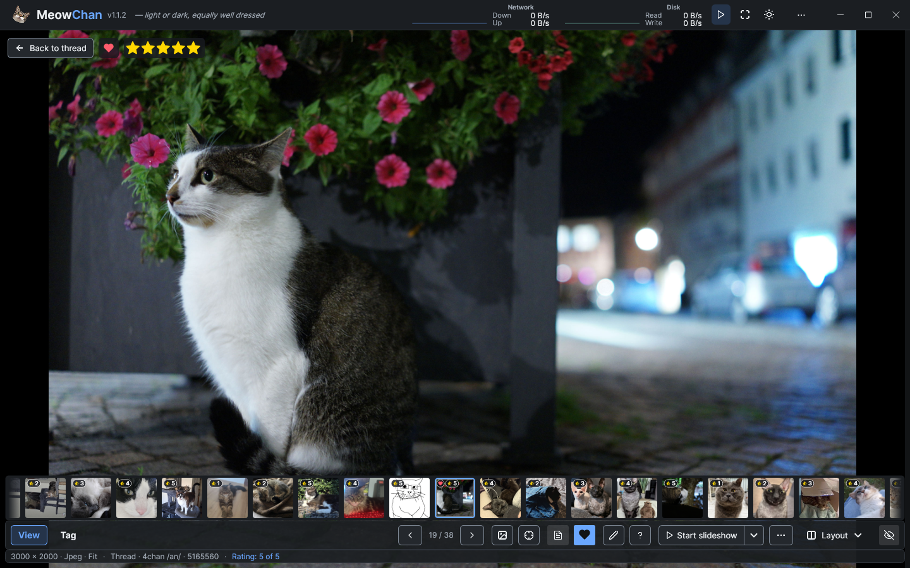
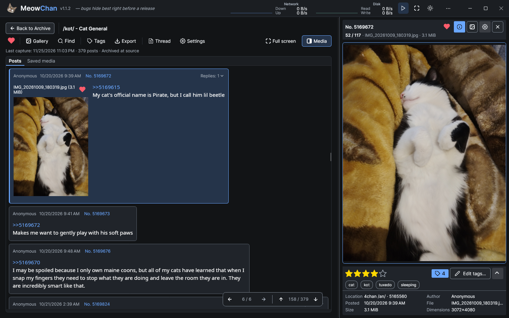
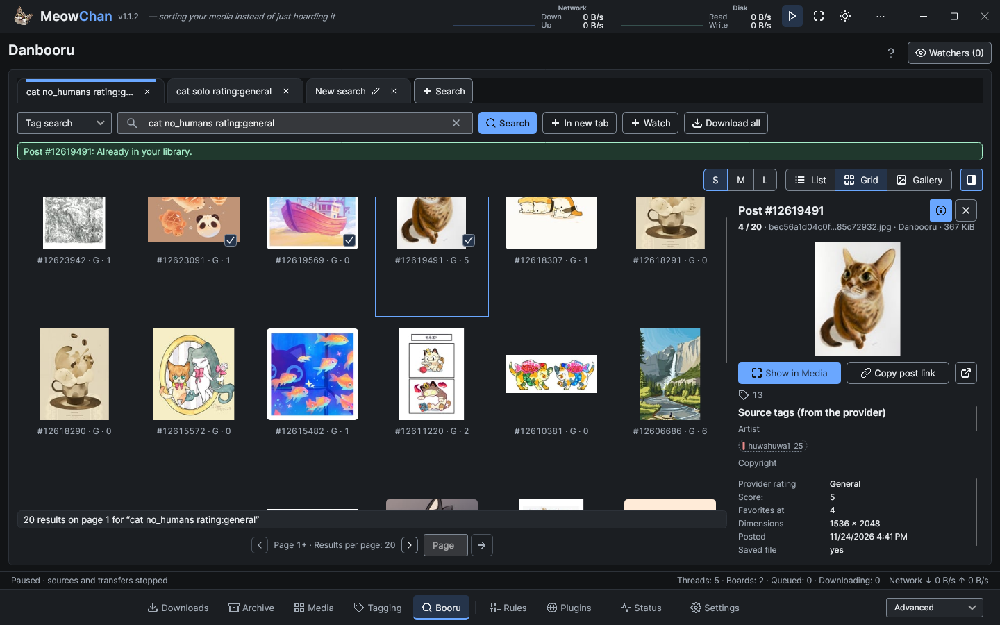
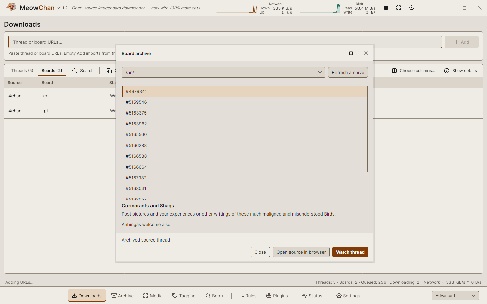
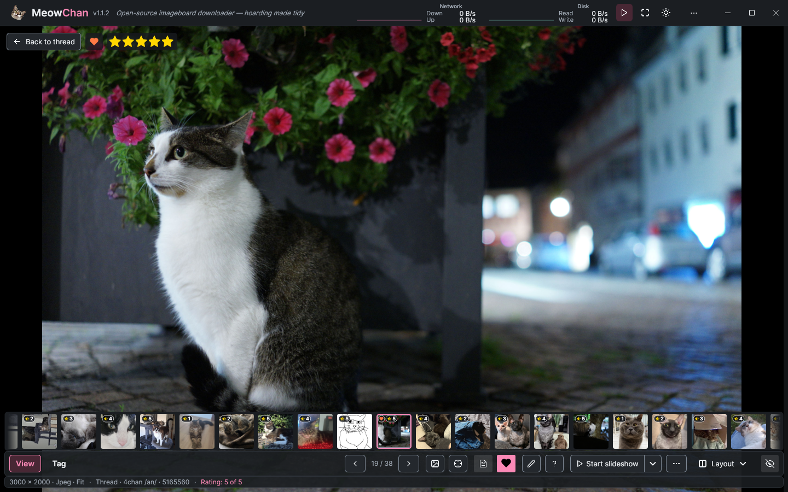
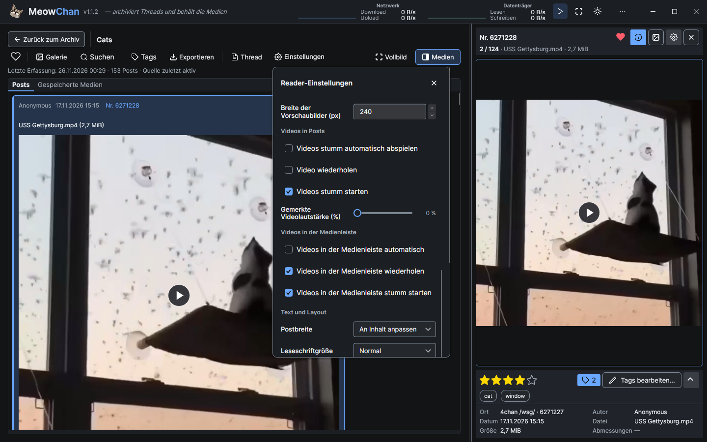
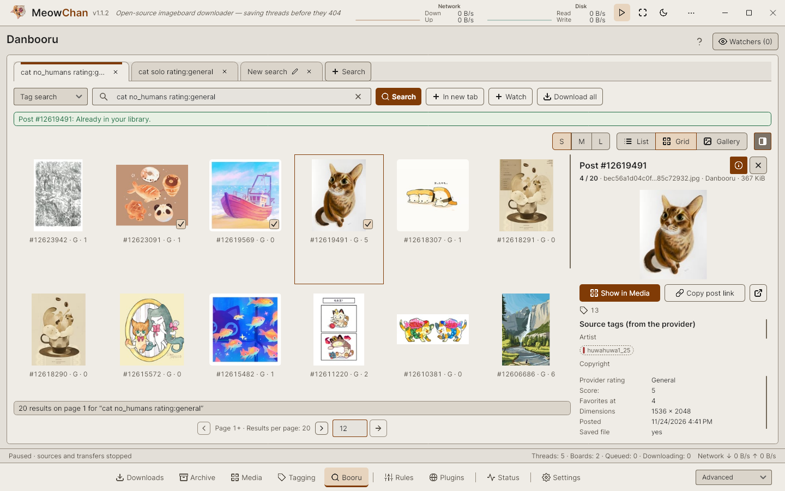
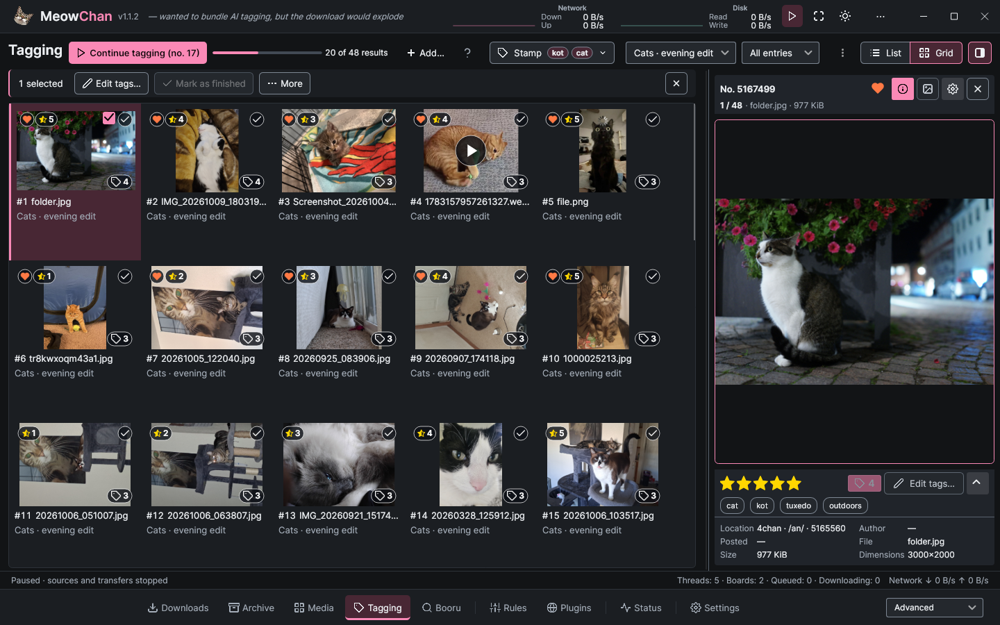

# MeowChan 1.1.2

## English

**The polish release.** Give a photo five stars, follow a quote deep into a thread, or pick up a half-finished tag search. MeowChan 1.1.2 makes those everyday actions easier and brings familiar controls to more views. We expect this to be the last major release in the 1.1.x series.

### Highlights

- **A heart for favourites, stars for ratings.** Click one of the five stars beside the gallery heart to rate the picture and keep browsing with the arrow keys.
- **Read a whole thread in one scroll.** The Reader continues past post 50 and loads posts around your reading position, so even long archived threads read as one conversation.
- **Take your sidebar settings with you.** Reader, Media and Tagging share video options, so you can choose how saved clips play once and use that choice across all three views.
- **Keep Booru searches within reach.** Page controls stay visible as you scroll, and on narrow screens the ⋯ menu keeps search actions one click away.
- **Pick up where you left off tagging.** List and Grid mark the next open file in your group or filter, and **Continue tagging** takes you straight to it.
- **Find a thread worth watching.** Browse a supported 4chan board’s archive from Downloads and read the opening post before adding the thread to your watches.

| Gallery · favourites and ratings | Reader · post 158 of 379 |
| --- | --- |
|  |  |

| Booru · search tabs | Downloads · board archive |
| --- | --- |
|  |  |

### Gallery & Media

- Click the selected gallery star again to clear the rating. Your position stays visible when you switch between the Post and Tags panels. At the end of the filmstrip, choose **Load more media** to keep going.
- The Reader, Media and Tagging sidebars let you rate, favourite and tag saved originals even above 80 MP. If a picture exceeds your preview limit, the sidebar explains why it skipped the preview. The limit defaults to 80 MP and can be set from 1 to 80 MP.

### Reader & Archive

- Follow a quote to a distant post or jump there with the navigator. When you search a thread, the counter between the arrows shows which match you’re reading.
- In **Saved media**, the sidebar follows the selected file revision in Grid and Table. The table distinguishes current and earlier revisions, shows file sizes in KiB, MiB or GiB, and lets you copy the full SHA-256 checksum.

### Tagging

- Move through List or Grid to preview the current file in the sidebar, play a saved video or edit tags in place.
- At the end of a round, you can revisit the files you skipped. While you work, **Back** shows which decision it will undo.

### Booru

- The sidebar follows the selected result and shows the provider’s tag count and score when supplied. From the same row, you can download the original, copy the post link or open the post in your browser.
- Add or exclude a Danbooru tag directly from a result. The current results stay in place until you submit your edits. With tab restoration enabled, even an unsent draft survives a restart.
- Jump directly to a page. **Watch** and **Download all / Stop** also work from the search field when their buttons move into ⋯. Their default shortcuts are **Ctrl+Shift+F7** and **Ctrl+Shift+F8** on Windows and Linux, or **⌥⌘W** and **⌥⌘L** on macOS.
- Show or hide the media sidebar with **Ctrl+Shift+M** on Windows and Linux or **⇧⌘M** on macOS.

### Downloads

- Paste a board archive URL to open the thread picker. When setting up a board watcher, you can use a title pattern suggested from recurring titles in your local archive, give the watcher a name and choose its check interval.
- If only the other tab has matches, a button shows how many and takes your search there. A mixed selection shows how many downloads you can check or retry. In the details, you can copy the URL and folder separately.

### Settings & Shortcuts

- Changes to autoplay, looping and mute in the Reader’s quick settings also reach Media and Tagging sidebars that are already open.
- Saved shortcuts keep their assignments when you upgrade from 1.1.1, even if a new default uses the same keys. The shortcut editor also updates its labels when you switch languages.

### Changed

- In the gallery, **Shift+I** now toggles facts. Use **Shift+Z** to show or hide the info line.
- In the Booru search field, **Enter** always searches in the current tab and **Shift+Enter** opens a new tab. The **New search opens in** setting from 1.1.1 has been retired.
- The **Minimum free height** setting for the media sidebar has been removed from Settings and the Reader’s quick settings.
- The [Help guide](../Help.md) and [README](../../README.md) cover the current gallery shortcuts and favourite heart.

### Platform

- On KDE Plasma, the tray menu stays steady when transfer statistics refresh during downloads. Its **Statistics** entry opens the live rates. On Windows the values update in the open menu, and on macOS they refresh when you open it.

### Fixes

- Click the opening button again to close a Reader or Archive popup, a plugin action menu, the Booru **Watchers** tab or the Booru **More** (⋯) menu.
- After a quick selection change in the Reader, rating and tag actions stay tied to the intended attachment.
- If you switch media while a save is in progress, a rating or tag change on the newly selected file is saved too.
- Copying a filename from the media sidebar or gallery now gives you the full filename, even when the display shortens it.
- If a picture exceeds the preview pixel limit, its tile explains that the picture is too large for the built-in preview.
- Archive remembers the table width you set across view changes and restarts.

### What’s next

- **1.1.3 is planned for later in November 2026**, with smaller improvements such as a more useful Reader sidebar for posts without media and clearer menu icons.
- **1.2.0 is planned for December 2026**, with bigger updates to browsing and selecting Booru results and to tagging images.

## Deutsch

**Das Update für den Feinschliff.** Ein Foto mit fünf Sternen bewerten, einem Zitat quer durch den Thread folgen oder eine angefangene Tag-Suche fortsetzen – mit MeowChan 1.1.2 geht das leichter von der Hand. Vertraute Bedienelemente findest du jetzt in mehr Ansichten wieder. Voraussichtlich ist dies das letzte große Release der 1.1.x-Reihe.

### Highlights

- **Ein Herz für Favoriten, Sterne für Bewertungen.** Mit einem Klick auf einen der fünf Sterne neben dem Galerie-Herz bewertest du das Bild und kannst gleich mit den Pfeiltasten weiterblättern.
- **Einen ganzen Thread am Stück lesen.** Der Reader scrollt über Beitrag 50 hinaus und lädt die Beiträge rund um deine Lesestelle, sodass du auch langen archivierten Gesprächen ohne Seitenwechsel folgen kannst.
- **Eine Videoeinstellung für drei Ansichten.** Reader, Medien und Tagging teilen sich die Videooptionen, sodass du das Abspielverhalten für gespeicherte Clips nur einmal einstellen musst.
- **Beim Blättern in Booru bleibt alles griffbereit.** Die Seitennavigation bleibt beim Scrollen sichtbar, und im schmalen Fenster erreichst du weitere Suchaktionen über das ⋯-Menü.
- **Eine Tagging-Runde dort fortsetzen, wo du aufgehört hast.** Liste und Raster markieren die nächste offene Datei der gewählten Gruppe oder Filterung, und **Weiter taggen** öffnet genau diese Datei.
- **Den passenden Thread zum Beobachten finden.** Öffne das Archiv eines unterstützten 4chan-Boards in den Downloads und lies den Eröffnungsbeitrag, bevor du den Thread beobachtest.

| Galerie · Favorit mit fünf Sternen | Reader · Videooptionen |
| --- | --- |
|  |  |

| Booru · Sprung zu Seite 12 | Tagging · Runde fortsetzen |
| --- | --- |
|  |  |

### Galerie & Medien

- Ein zweiter Klick auf den ausgewählten Stern entfernt die Bewertung. Beim Wechsel zwischen „Post“ und „Tags“ bleibt deine Position sichtbar. Am Ende des Filmstreifens geht es mit **Weitere Medien laden** weiter.
- In den Sidebars von Reader, Medien und Tagging kannst du gespeicherte Originale auch über 80 MP bewerten, als Favorit markieren und taggen. Überschreitet ein Bild deine Vorschaugrenze, erklärt die Sidebar, warum die Vorschau ausbleibt. Die Grenze liegt standardmäßig bei 80 MP und lässt sich zwischen 1 und 80 MP einstellen.

### Reader & Archiv

- Über ein Zitat oder den Navigator springst du auch zu weit entfernten Beiträgen. Bei der Suche im Thread zeigt der Zähler zwischen den Pfeilen, welchen Treffer du gerade liest.
- Unter **Gespeicherte Medien** folgt die Sidebar im Raster und in der Tabelle der ausgewählten Dateifassung. Die Tabelle unterscheidet aktuelle und frühere Fassungen, zeigt Dateigrößen in KiB, MiB oder GiB und lässt dich die vollständige SHA-256-Prüfsumme kopieren.

### Tagging

- Wenn du durch Liste oder Raster gehst, siehst du die aktuelle Datei in der Sidebar. Dort kannst du gespeicherte Videos abspielen und Tags direkt bearbeiten.
- Am Ende einer Runde kannst du die übersprungenen Dateien noch einmal durchsehen. Beim Taggen zeigt **Zurück**, welche Entscheidung du damit rückgängig machst.

### Booru

- Die Sidebar folgt dem ausgewählten Treffer und zeigt Tag-Anzahl und Score, sofern der Anbieter sie liefert. In derselben Zeile kannst du das Original herunterladen, den Link zum Post kopieren oder den Post im Browser öffnen.
- Übernimm einen Danbooru-Tag direkt aus einem Treffer in die Suche oder schließe ihn aus. Die bisherigen Treffer bleiben sichtbar, bis du die Änderung abschickst. Wenn du deine Suchreiter beim Start wiederherstellst, bleibt auch ein ungesendeter Entwurf erhalten.
- Springe direkt zu einer Seite. **Beobachten** und **Alle laden / Stoppen** funktionieren per Kürzel im Suchfeld auch dann, wenn ihre Knöpfe ins ⋯-Menü wandern. Unter Windows und Linux sind dafür **Strg+Umschalt+F7** und **Strg+Umschalt+F8** voreingestellt, unter macOS **⌥⌘W** und **⌥⌘L**.
- Mit **Strg+⇧+M** unter Windows und Linux oder **⇧⌘M** unter macOS blendest du die Medienleiste ein oder aus.

### Downloads

- Füge die URL eines Boardarchivs ein, um die Threadauswahl zu öffnen. Beim Einrichten einer Board-Beobachtung kannst du ein Titelmuster aus wiederkehrenden Titeln deines lokalen Archivs übernehmen, einen Namen vergeben und das Prüfintervall wählen.
- Findet die Suche nur im anderen Reiter Treffer, zeigt dir ein Knopf deren Anzahl und übernimmt beim Wechsel den Suchtext. Bei gemischter Auswahl siehst du, wie viele Downloads du prüfen oder erneut versuchen kannst. In den Details lassen sich URL und Ordner getrennt kopieren.

### Einstellungen & Tastenkürzel

- Änderst du in den Reader-Schnelloptionen die automatische Wiedergabe, die Schleife oder die Stummschaltung, gilt die Änderung auch in bereits geöffneten Medien- und Tagging-Sidebars.
- Beim Upgrade von 1.1.1 behalten gespeicherte Kürzel ihre Belegung, auch wenn ein neuer Standard dieselben Tasten verwendet. Wechselst du die Sprache, erscheinen die Beschriftungen im geöffneten Kürzeleditor sofort in der neuen Sprache.

### Geändert

- In der Galerie blendet **⇧I** jetzt die Fakten ein oder aus. Die Infozeile schaltest du mit **⇧Z** um.
- Im Booru-Suchfeld sucht **Enter** immer im aktuellen Reiter. **⇧Enter** öffnet einen neuen Reiter. Die Einstellung **Neue Suche öffnet in** aus 1.1.1 entfällt.
- Die Einstellung **Freie Mindesthöhe** für die Medienleiste entfällt in den Einstellungen und den Reader-Schnelloptionen.
- Die [Hilfe](../Help.md) und die [README](../../README.md) beschreiben die aktuellen Galeriekürzel und das Favoritenherz.

### Plattform

- Unter KDE Plasma bleibt das Tray-Menü ohne Flackern geöffnet, wenn sich die Übertragungsraten während eines Downloads ändern. Über **Statistik** kommst du zu den Live-Werten. Unter Windows aktualisieren sich die Werte im offenen Menü, unter macOS beim Öffnen.

### Fehlerbehebungen

- Ein zweiter Klick auf denselben Knopf schließt das Reader- oder Archiv-Popup, das Plugin-Aktionsmenü, den Booru-Reiter **Suchbeobachtungen** oder das Booru-Menü **Mehr** (⋯).
- Auch nach einem schnellen Auswahlwechsel im Reader bleiben Bewertungen und Tag-Änderungen dem richtigen Anhang zugeordnet.
- Wechselst du während des Speicherns das Medium, wird auch eine Bewertung oder Tag-Änderung an der neu ausgewählten Datei gespeichert.
- Beim Kopieren aus der Medienleiste oder Galerie erhältst du den vollständigen Dateinamen, auch wenn die Anzeige ihn kürzt.
- Überschreitet ein Bild die Pixelgrenze für Vorschauen, erklärt die Kachel, dass das Bild für die integrierte Vorschau zu groß ist.
- Das Archiv merkt sich die eingestellte Tabellenbreite über Ansichtswechsel und Neustarts hinweg.

### Ausblick

- **1.1.3 ist noch für November 2026 geplant**, mit kleineren Verbesserungen etwa an der Reader-Sidebar für Beiträge ohne Medien und an den Menüsymbolen.
- **1.2.0 ist für Dezember 2026 geplant** und bringt voraussichtlich größere Erweiterungen beim Durchsehen und Auswählen von Booru-Treffern sowie beim Taggen von Bildern.

## Downloads

All desktop variants include .NET. Choose the platform label and package type for your system. The desktop filenames use the `01`–`09` prefixes to keep them in the order shown here.

| Platform / package | Download |
|---|---|
| Windows x64 (.zip) | [01-MeowChan-1.1.2-win-x64.zip](https://github.com/grassmann-it/MeowChan/releases/download/v1.1.2/01-MeowChan-1.1.2-win-x64.zip) |
| macOS Apple Silicon (.dmg) | [02-MeowChan-1.1.2-osx-arm64.dmg](https://github.com/grassmann-it/MeowChan/releases/download/v1.1.2/02-MeowChan-1.1.2-osx-arm64.dmg) |
| macOS Intel (.dmg) | [03-MeowChan-1.1.2-osx-x64.dmg](https://github.com/grassmann-it/MeowChan/releases/download/v1.1.2/03-MeowChan-1.1.2-osx-x64.dmg) |
| Linux x64 (.AppImage) | [04-MeowChan-1.1.2-linux-x64.AppImage](https://github.com/grassmann-it/MeowChan/releases/download/v1.1.2/04-MeowChan-1.1.2-linux-x64.AppImage) |
| Linux ARM64 (.AppImage) | [05-MeowChan-1.1.2-linux-arm64.AppImage](https://github.com/grassmann-it/MeowChan/releases/download/v1.1.2/05-MeowChan-1.1.2-linux-arm64.AppImage) |
| Linux x64 — bundled VLC (.tar.gz) | [06-MeowChan-1.1.2-linux-x64-bundled-vlc.tar.gz](https://github.com/grassmann-it/MeowChan/releases/download/v1.1.2/06-MeowChan-1.1.2-linux-x64-bundled-vlc.tar.gz) |
| Linux x64 — system VLC (.tar.gz) | [07-MeowChan-1.1.2-linux-x64-system-vlc.tar.gz](https://github.com/grassmann-it/MeowChan/releases/download/v1.1.2/07-MeowChan-1.1.2-linux-x64-system-vlc.tar.gz) |
| Linux ARM64 — bundled VLC (.tar.gz) | [08-MeowChan-1.1.2-linux-arm64-bundled-vlc.tar.gz](https://github.com/grassmann-it/MeowChan/releases/download/v1.1.2/08-MeowChan-1.1.2-linux-arm64-bundled-vlc.tar.gz) |
| Linux ARM64 — system VLC (.tar.gz) | [09-MeowChan-1.1.2-linux-arm64-system-vlc.tar.gz](https://github.com/grassmann-it/MeowChan/releases/download/v1.1.2/09-MeowChan-1.1.2-linux-arm64-system-vlc.tar.gz) |

[SHA256 checksums](https://github.com/grassmann-it/MeowChan/releases/download/v1.1.2/SHA256SUMS). The `*-video-sources.tar.gz` archives are the corresponding source for the bundled video libraries.

Linux system-VLC archives require compatible LibVLC 3 ≥ 3.0.20 plus media/output plugins. The bundled-VLC variants include the private runtime. macOS packages are ad-hoc signed and not notarized.

## Validation status

Package and platform validation pending.
